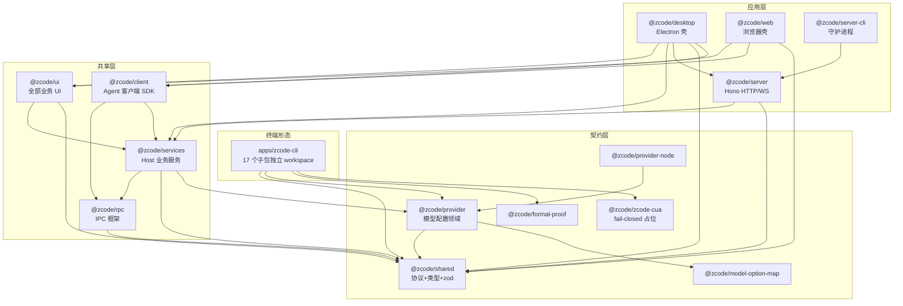
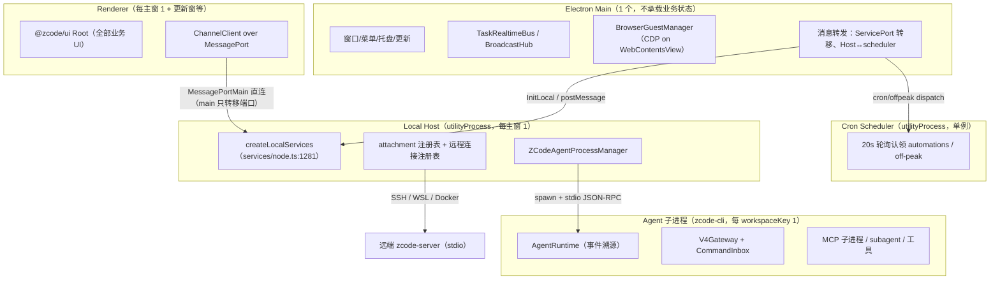
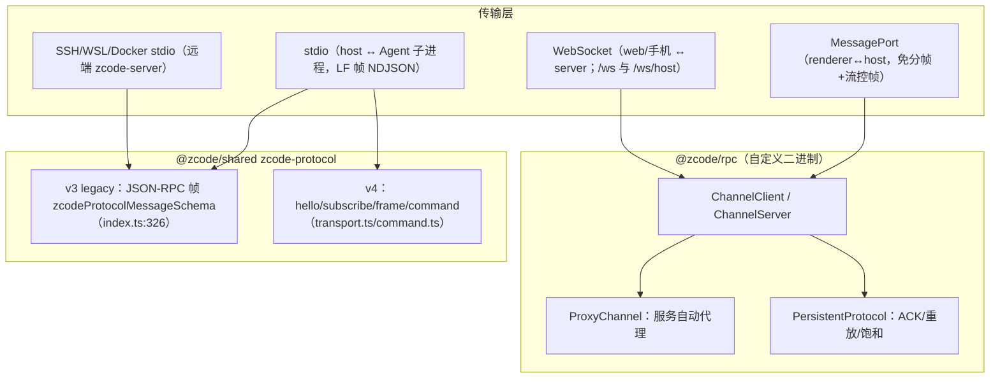

# 01 · 全局架构

> 证据均以当前检出源码为准（commit `872ad96`）。粒度：包 / 模块 / 关键类与数据结构。

## 1. 技术栈全景

| 层 | 技术 | 证据 |
| --- | --- | --- |
| 语言/运行时 | TypeScript 6、Node ≥24（mise 锁 24.14.0）、ESM 优先（root `"type":"module"`） | `package.json:2,79-80`、`mise.toml:1-3` |
| 桌面 | Electron（main/preload/host/scheduler 四 bundle，tsup） | `packages/desktop/tsup.config.ts:139-239` |
| UI | React 19.2.7（pnpm overrides 锁定）、Zustand（无 persist 中间件，手写持久化）、tailwind 系 DESIGN token | `package.json:83-86`、`DESIGN.md` |
| Web | Vite + React；后端 Hono + `@hono/node-server` + `@hono/node-ws` | `packages/server/package.json:19-21`、`src/http.ts:6-8` |
| 终端 | TUI：OpenTUI + React 19（非 ink） | `apps/zcode-cli/packages/tui/package.json` |
| RPC | 自研 VS Code 风格 IPC（二进制序列化 + 13 字节帧 + 懒事件） | `packages/rpc/src/index.ts:1-29` |
| 协议校验 | zod 4.6.5（shared/services/ui）+ zod 3.24（cli contracts），双实例隔离 | `packages/shared/package.json`、`apps/zcode-cli/packages/contracts/package.json:100` |
| 持久化 | node:sqlite（`DatabaseSync`）+ JSON 文件（原子写 + 文件锁） | `services/src/session/tasksDatabase/startup.ts:6-8` |
| 终端模拟 | node-pty（Host 侧懒加载）+ @xterm/xterm（UI） | `services/src/terminal/terminalService.ts:28-43` |
| 模型接入 | @ai-sdk（anthropic / openai-compatible，带 video 输入 patch） | root `package.json:87-91`、`patches/` |
| 质量 | oxlint（max-lines 400）、oxfmt、knip、tsc -b 12 项目引用 | `.oxlintrc.json`、`package.json:29` |

## 2. 包依赖图

依赖方向（导入方 → 被导入方），由各包 `package.json` 的 `workspace:*` 声明归纳：

要点：

- `@zcode/shared` 是零 IO 契约包：运行时依赖仅 `zod` + `@zcode/model-option-map`；例外是 workspace-hook 子族依赖 `node:fs/node:crypto`，经独立 subpath 暴露（`packages/shared/src/zcode-protocol-v4/core.ts:2` 纪律注释）。
- 「contracts → shared、永不反向」是 CLI 侧铁律（`apps/zcode-cli/packages/contracts/.../workflow-runs-reducer.ts:11` 注释）。
- `apps/zcode-cli` 是嵌套 pnpm workspace（自带 lockfile + turbo），但其构建 inputs 显式包含外层仓库的 `packages/shared|provider` 源码（`apps/zcode-cli/turbo.json:57-80`）——跨仓源码消费。

## 3. 分层与进程模型（桌面形态）

- 进程类型共 5 类：Main、Renderer、Local Host、Cron Scheduler、Agent（及其派生 MCP/PTY/CUA Helper 等）——清单与通道见 [packages/05-desktop.md](packages/05-desktop.md) §10。
- 通信通道四族：`PlatformChannels`（renderer↔main，约 110 个，`packages/shared/src/channels.ts:158-424`）、`HostMessageTypes`/`HostResponseTypes`（main↔host，30/47 个，`channels.ts:505/559`）、`ServiceChannels`（RPC 服务频道 40+，`channels.ts:74`）、scheduler 私有协议（`schedulerProtocol.ts`）。

## 4. 协议栈总览

- RPC 框架与 Agent 协议是**两套正交体系**：前者承载「UI ↔ Host 服务」（任意 IServiceAccessor 调用），后者承载「Host ↔ Agent 子进程」的会话/任务语义。
- V4 wire 层定义物理分片（1MiB 帧上限、crc32、base64 分片装配），逻辑层定义快照 + 五种封闭增量操作与 33 个命令（详见 [packages/01-shared-protocol.md](packages/01-shared-protocol.md)）。

## 5. 关键设计模式（附位置）

| 模式 | 实现 | 位置 |
| --- | --- | --- |
| 服务定位器 / DI | `ServiceCollection` + `ServiceDescriptor`（channel 名 + phantom 类型），`exposeOnChannelServer` 自动注册 | `services/src/collection.ts:12-41`、`descriptors.ts:14-16` |
| 自动代理（ES6 Proxy） | `ProxyChannel.fromService/toService` 把服务接口转 RPC 代理 | `packages/rpc/src/proxy-channel.ts` |
| 事件溯源 | Agent 会话 = 事件流（appendEvent → sqlite），投影由 `EventReducer` 重放 | `core/src/runtime/methods/events.ts:81-147`、`contracts/src/events/event-reducer.ts:74` |
| 端口-适配器 | core 依赖 contracts 端口接口，Node 实现在 adapters | `apps/zcode-cli/packages/contracts`、`adapters` |
| 租约/代际守卫 | TaskRunLease、restartGeneration、writeGeneration、invalidationVersion | `desktop/src/main/taskRealtimeBus.ts:142-183`、`zcodeAgentProcessManager.ts:988-999` |
| 单飞（single-flight） | Agent 进程启动并发收敛 `startingByWorkspaceKey` | `zcodeAgentProcessManager.ts:832-887` |
| 乐观更新 + 权威收敛 | UI optimisticCommands overlay → 2s 宽限自愈；taskUnreadOverlay | `ui/src/v4/conversationProjectionStore.ts:1202-1296`、`taskQueryCacheStore.ts:373-383` |
| 防回环广播 | `applyingBroadcast` 闭包标志 + `BROADCAST_FIELDS` 白名单 | `ui/src/store/index.ts:214,436-488` |
| 原子写 + 文件锁 | setting.json/credentials.json：tmp→rename + withFileLock | `services/src/setting/settingService.ts:184-218`、`credential/credentialService.ts:104-115` |
| 受控上下文 | `architecture:context` 输出模块契约阅读包 | `scripts/architecture/index.mjs:325-359` |

## 6. 架构治理（目标态 vs 现状）

`architecture-policy.yaml` 定义 14 个模块；唯一 `managed: true` 的是 `services/storage`（domain→app→adapters 三层，公开入口 `contract.ts`）。`session` 模块声明的 `session/contract.ts` 在磁盘上不存在（仍为 legacy）——策略是目标态而非现状。检查算法（行数/契约行数/公开方法数/domain-io/层向/深导入/环检测 + baseline 指纹 + `--changed` 反向依赖扩集）详见 [03-workflow.md](03-workflow.md) §4。

## 7. 三形态共用内核

桌面 renderer、Web 浏览器、TUI 共用同一套业务内核：

- **UI 共用**：`@zcode/ui` 的 `Root`（`packages/ui/src/Root.tsx:104`）；桌面与 Web 仅注入不同 `IPlatformService`（`desktopPlatform.ts` vs `createWebPlatform`，`web/src/main.tsx:190-352`）。
- **Agent 共用**：`zcode-cli` 的 `AgentRuntime` 同时服务 TUI（进程内直连）、Desktop Host（spawn + stdio）、Web server（spawn + stdio）。
- **投影共用**：V4 snapshot/delta 的装配与应用逻辑（shared 的 `apply.ts`）被桌面 store、Web 回放页（`ui/src/replay.ts` re-export 桶）与 TUI 侧共同复用。
