# 02 · 运行原理

> 启动流程、核心数据流、状态机与错误处理链。所有流程均配 Mermaid 图；行号为当前检出源码。

## 1. 桌面版启动流程

阶段 0（模块加载期）→ 阶段 1（app.whenReady）→ 阶段 2（dom-ready 后 Host 拉起）。关键函数链：

`app.whenReady`（`desktop/src/main/index.ts:1856`）→ `primaryWindowCoordinator.ensurePrimaryWindow("app-ready")`（`index.ts:885,2209`）→ `createWindowInstance`（`index.ts:1672`）→ `createWindow`（`desktopWindowLifecycle.ts:24`）→ `createBrowserWindow`（`desktopWindowChrome.ts:540`，注入 preload + contextIsolation）→ `loadWindow`（`desktopHostProcess.ts:109`）→ dom-ready → `spawnHostProcess`（`desktopHostProcess.ts:151`，`utilityProcess.fork` + `postMessage(InitLocal,[port2])`）→ `win.webContents.postMessage(ServicePort,[port1])`（`:568-574`）→ renderer `initializeBusinessRoot`（`renderer/src/main.tsx:303`）→ `@zcode/ui` Root 渲染；Host 侧并行执行 `InitLocal` → DB 启动协调 → base attachment。

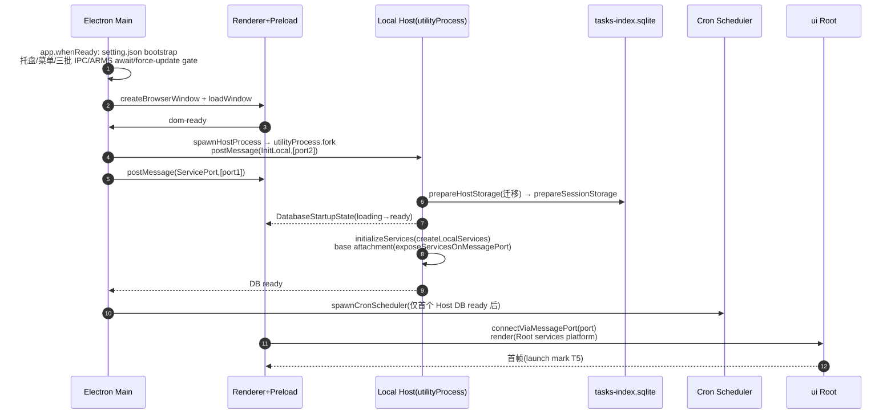

细节（每步的证据）：见 [packages/05-desktop.md](packages/05-desktop.md) §2。

## 2. 用户消息全链路（桌面形态，最重要数据流）

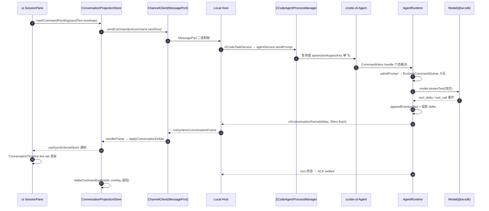

变量级变换（上行方向）：

| 步骤 | 变量/对象 | 类型 | 变化 |
| --- | --- | --- | --- |
| 输入框提交 | `text + attachments` | `string + AttachmentRef[]` | 附件先行上传（begin→384KiB chunk→commit，`ui/src/v4/attachmentUploadTransaction.ts:122-212`） |
| 命令构造 | `CommandEnvelope` | `{commandId(uuidv7), clientId, sessionId, baseRevision, type:"sendText", payload}` | `shared/zcode-protocol-v4/command.ts:320` |
| 协议 admission | `outcome` | `accepted/rejected/stale/duplicate/noop/failed` | `bootstrap command-inbox.ts:308-444` |
| core admission | 返回值 | `{kind:"started", turnId}` 或 `{kind:"queued"/"steered"}` | `core prompt-admission.ts:20-126` |
| 下行投影 | `deltas` | `row.appended/row.delta/state.updated` 等 5 操作 | `shared/zcode-protocol-v4/delta.ts:53` |

## 3. 握手流程（两条链路）

### 3.1 远端 stdio 握手（zcode-hello）

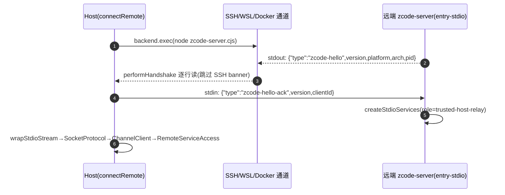

证据：`server/src/entry-stdio.ts:41-52,90-128`、`server/src/remote/handshake.ts:20-126`、类型 `shared/src/handshake.ts:1-13`。

### 3.2 V4 能力握手（hello/clientHello）

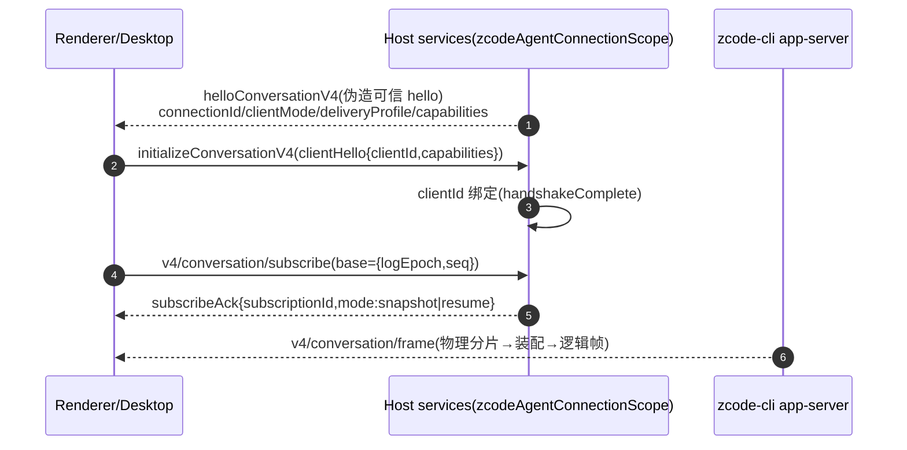

证据：`services/src/zcode-agent/zcodeAgentService.ts:4875-4911`、`zcodeAgentConnectionScope.ts:649-698`（clientId 不匹配抛 `fault.command.clientMismatch`）。注意：CLI 的 app-server 本身不发 `zcode-hello`（那是远端 server 专用）；它的握手是 V4 wire 层。

## 4. V4 帧下行：编码 → 分片 → 装配 → 应用

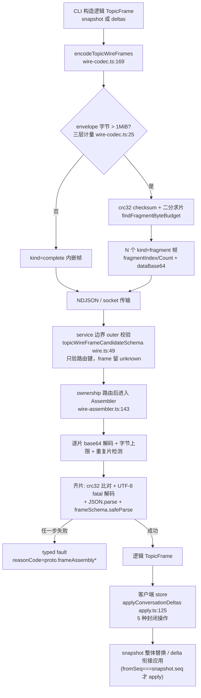

设计动机（代码注释佐证）：坏帧必须进入 owned assembler 产出 typed fault，不能在 service 边界 warn/drop 后让 store 永久等待（`wire.ts:54-62`）。

## 5. 远程工作区连接（SSH/WSL/Docker 部署链路）

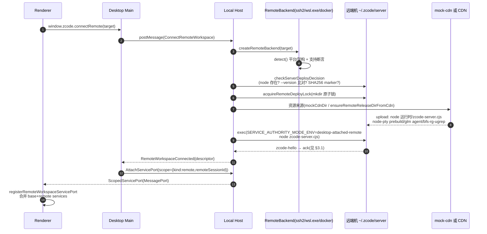

证据链：`desktop/src/host/index.ts:2537-2616`（ConnectRemoteWorkspace 分支）、`server/src/remote/deploy.ts:95-550`、`connect.ts:109-322`。手机远控复用同一 Host attachment，以 `clientMode:"web-remote-replayable"` 接入（`desktop/src/main/desktopRemoteSessions.ts:832-892`）。

## 6. 手机 / Web 远控接入（web-remote-replayable）

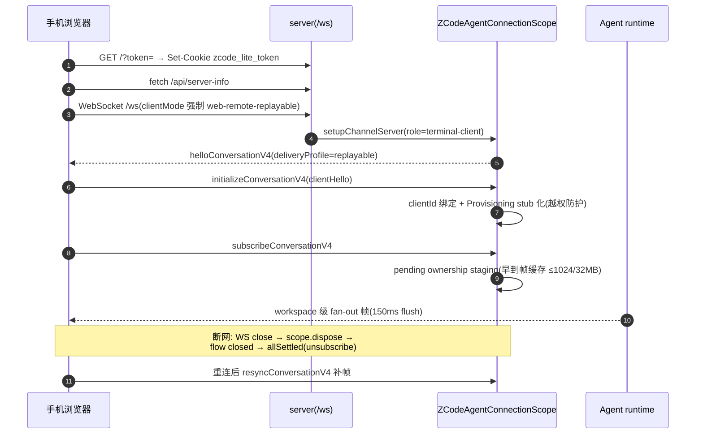

证据：`server/src/http.ts:322-343`（强制 clientMode）、`zcodeAgentConnectionScope.ts:164-166,429-445,590-602`。

## 7. 核心状态机汇总

### 7.1 会话 phase（V4）

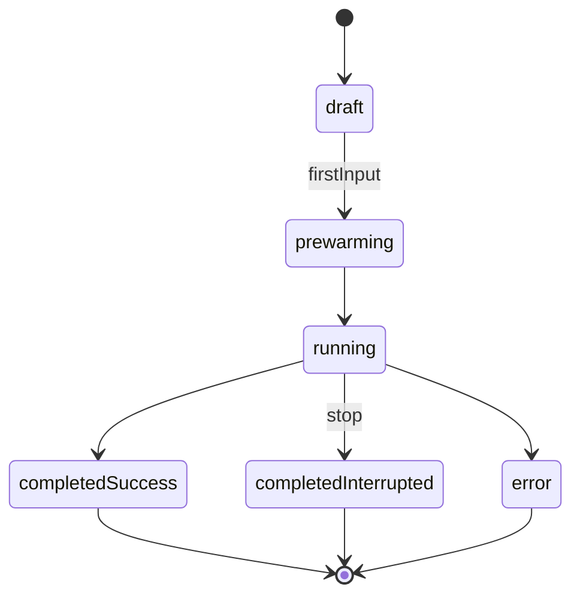

`shared/src/zcode-protocol-v4/snapshot.ts:28`（draft 纯内存，重启即失）。

### 7.2 Agent turn 状态机（core）

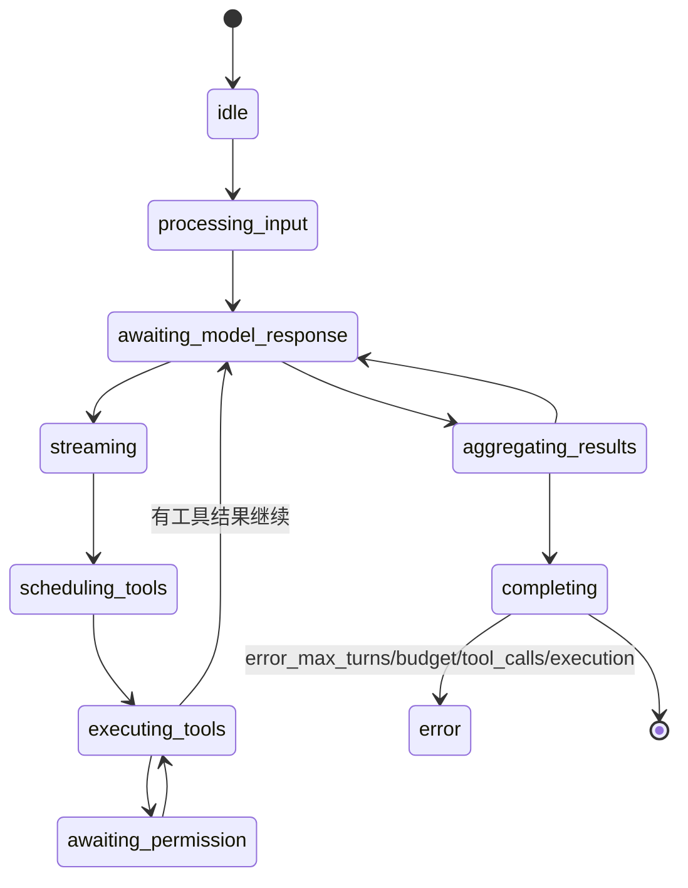

`apps/zcode-cli/packages/core/src/agent/turn-state.ts:25-38,230-263`（`TurnPhase` + 合法转移表 `canTransitionTo`）。

### 7.3 工具调用行（V4 投影）

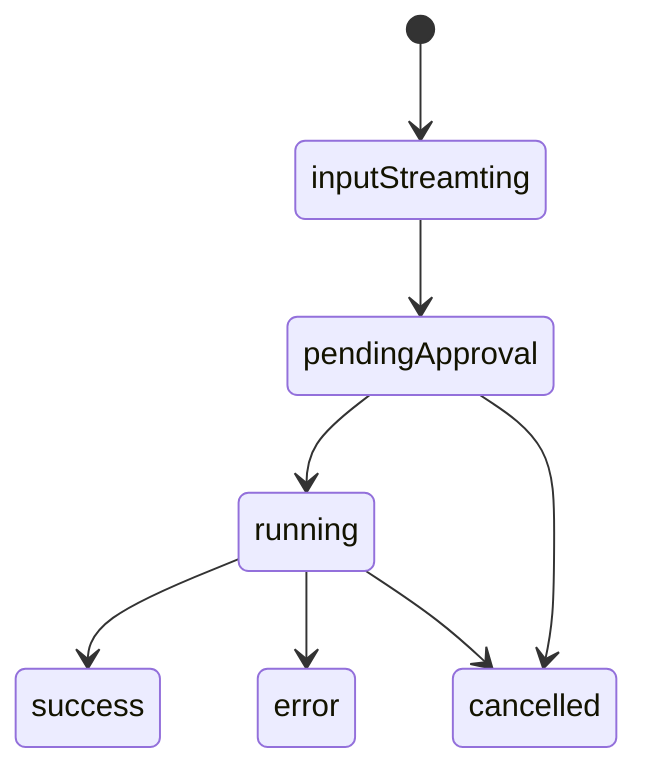

`shared/src/zcode-protocol-v4/rows.ts:198`。

### 7.4 Workspace hook 信任状态

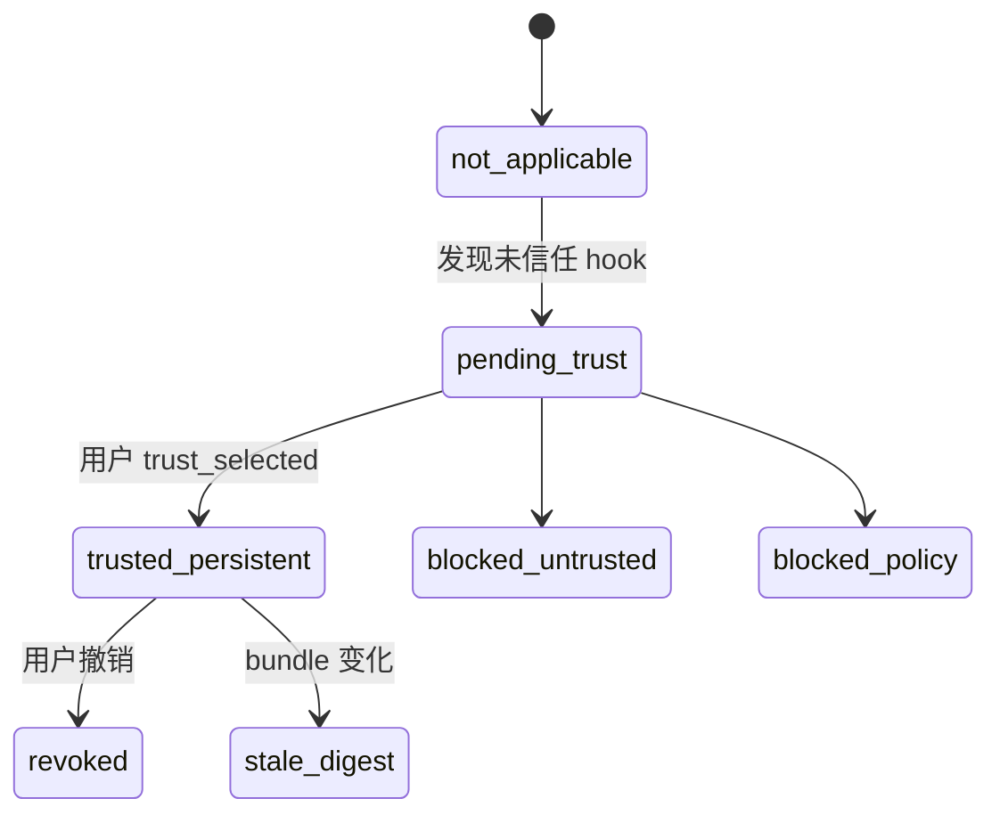

`shared/src/zcode-protocol-v4/workspace-hook-review.ts:9`；trust store 非法即整体 fail-closed（`workspace-hook-trust-store-file.ts:6-14`）。

### 7.5 其余关键状态枚举

| 领域 | 枚举 | 位置 |
| --- | --- | --- |
| 任务持久状态 | `running / completed / error`（终态保护，旧终态不被晚到非终态覆盖） | `taskIndexRepo.ts:173-184` |
| UI TaskRuntime | `notReady / idle / creating / restoring / ready / streaming / completed / failed` | `shared/zcode-task-types-core.ts:163` |
| 停止 | stopState `idle/stoppable/stopping` | `snapshot.ts:133` |
| 输入路由 | `startNow / enqueue / guide / reject / choice` | `snapshot.ts:163` |
| 队列项 | `admitted→queued→reserved→promoting→drained` | `v4/input-intent.ts:34` |
| goal | `active⇄paused→verifying→verified/notSatisfied/failed` | `snapshot.ts:418-427` |
| workflow run | `pending/running→completed/errored/stopped`；stopReason 6 值 | `workflow-runs.ts:310` |
| MCP server | `connecting/connected/disconnected/failed/disabled/untrusted` | `zcode-protocol/index.ts:655` |
| 模型切换（UI） | `idle→settingModel→…→persistingWorkspace` 8 阶段 | `zcodeSessionStoreTypes.ts:115-122` |
| 附件上传 | `waitingSession→queued→uploading→committing→ready/failed` | `composerAttachmentUploadStore.ts:8-15` |
| 投影连接 | `connecting→live→error(retry)→closed` | `conversationProjectionStore.ts:85-93` |
| Supervisor（server-cli） | `starting→ready→stopping→stopped`；crash 退避重启 | `supervisor/contracts.ts:9-20` |

## 8. 错误处理与恢复链

| 故障点 | 处理 | 证据 |
| --- | --- | --- |
| Agent 进程崩溃（exit 非预期） | stderr drain → 遥测 → 删 pool entry → 按进程组幂等回收（SIGTERM→SIGKILL）；UI 仅在 spawn 事件后收 `onRuntimeRestarted`（防自激风暴） | `zcodeAgentProcessManager.ts:1276-1336,1137-1145` |
| Agent 请求超时 | 看门狗：协议链路不可信即整树回收（watchdog_recycle） | `zcodeAgentProcessManager.ts:1276-1311` |
| Host（utilityProcess）崩溃 | main exit handler 清全部注册表；renderer reload 发现旧 Host 已死则 respawn | `desktopHostProcess.ts:597-614`、`desktopWindowLifecycle.ts:167-179` |
| RPC 连接终结 | `ChannelClient.dispose` 把所有 pendingRejections fail-closed reject（防 in-flight Promise 永久占用 workspace key） | `packages/rpc/src/channelClient.ts:249-274` |
| RPC 无 ACK 20s | PersistentProtocol `onSocketClose` → RemoteAgentConnection 重连（延迟表 0/5/5/10…30s），重放未 ACK 消息；越界（8MB/45s）则 abandonSession 走 subscribe(base) 恢复 | `persistent-protocol.ts:240-275`、`remote.ts:247-322` |
| V4 断档 | 客户端不猜：携带水位 `{logEpoch,seq}` 重订阅，服务端裁决 resume/snapshot | `conversationProjectionStore.ts:2-7,866-876` |
| runtime 换代 | 旧 ACK 迟到拒收，不向新 runtime 反向 unsubscribe | `zcodeAgentConnectionScope.ts:604-646` |
| sqlite 迁移竞争 | `BEGIN IMMEDIATE` + 60min 锁等待 + checksum 账本（不匹配抛 `checksum_mismatch`） | `tasksDatabase/migrations.ts:44-138` |
| setting.json 损坏 | 短重试 3×300ms → 隔离为 `.corrupt-{ts}` → 回默认 | `settingService.ts:72-94` |
| credentials.json 损坏 | 备份后拒绝自动覆盖 | `credentialService.ts:62-72` |
| 上下文超窗 | reactive compact（恢复模型步）+ autoCompact + microcompact 三层 | `core turn-model-step.ts:429-441,742-803` |
| 流中断恢复 | `streaming-recovery.ts` 断流重发 + Start-Plan busy 短重试 | `core/src/runtime/methods/streaming-recovery.ts` |
| 更新安装前进程占用（Windows） | 扫描持有安装资源句柄的进程并 `taskkill /T /F` | `desktop/src/main/index.ts:1252-1304` |
| app 退出屏障 | `before-quit` preventDefault → `prepareAppQuit`（遥测 flush 2s、cron dispose、全部 Host disposeAndWait，强杀延迟 ≥3.5s 防 agent 孤儿）→ 再 re-quit | `index.ts:1097-1304`、`desktopHostProcess.ts:644-656` |

## 9. 关键调用链索引（≥3 层，详见各包报告）

1. 会话创建：`zcodeSessionService.createSession` → `agentService.getClient` → `processManager.startClient(spawn)` → `client.request(session/create)` → syncer 广播（`services` §链1）。
2. 插件安装：`pluginManagementService` → `agentService.getPluginManagementClient`（专用控制面进程）→ `plugins/install` → agent 落盘 `~/.zcode/plugins`（`services` §链2）。
3. 设置写入：`observableSettingService.update` → 两段队列（updateQueue + writeQueueGeneration）→ `atomicWriteText` → onDidUpdate 派发（`services` §链3）。
4. RPC 单次调用：Proxy 拦截 → `ChannelClient.requestPromise` → serialize → `protocol.send` → 对端 `ChannelServer.onPromise` → 回包 resolve（`rpc` §链A）。
5. Agent turn：`executeTurn` 入队 → `runRegularTurnLoop` → `runModelBackedTurnStep` → `executeToolCallsForModelStep`（`zcode-cli` §1）。
