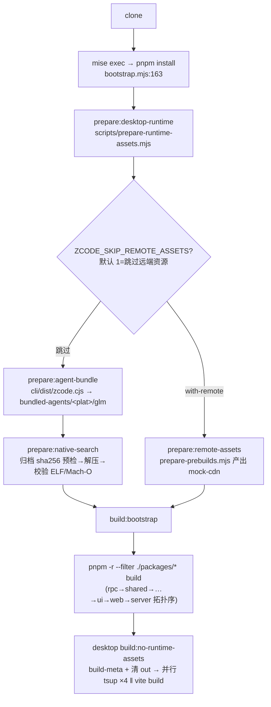
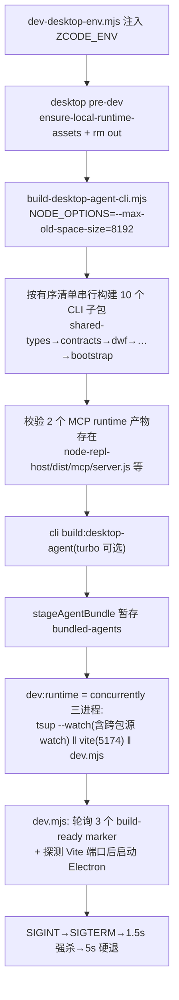
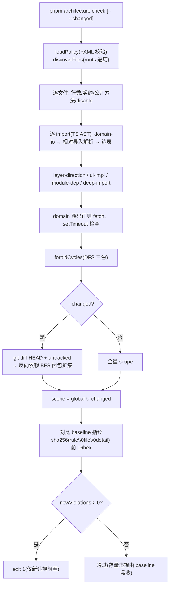
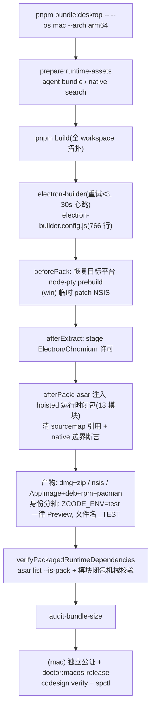

# 03 · 开发与构建工作流

> 仓库级工具链与交付管线（业务包内部见 packages/ 系列）。CI 配置未随开源发布，行为契约嵌在脚本注释与环境变量中。

## 1. 环境与工具链入口

| 项 | 值 | 证据 |
| --- | --- | --- |
| Node | 24.14.0（mise 锁定；`.nvmrc`=24；engines ≥24） | `mise.toml:1-3`、`package.json:78-80` |
| pnpm | 10.33.2，node-linker=hoisted | `package.json:81`、`.npmrc:1` |
| mise tasks | install / bootstrap / dev（`ZCODE_DATA_BASE_DIR=~/.zcode-dev-home` 跑 test 环境）/ dev-desktop-prod / dev-web / typecheck / lint | `mise.toml:9-37` |
| Node PATH 防抢跑 | `mise-run.mjs:14-20` 用 `withPinnedNodePath` 把启动器 Node 前置 | `scripts/mise-toolchain-env.mjs:11-26` |
| Electron 镜像 | `ELECTRON_MIRROR=https://npmmirror.com/mirrors/electron/` | `mise.toml:7` |
| 开工检查 | `node scripts/check-workspace-freshness.mjs`：落后 upstream 即失败；非特性分支落后 main>50 失败 | `check-workspace-freshness.mjs:9-78` |

## 2. `pnpm bootstrap` 完整流程

要点：

- `git submodule update --init --recursive apps/zcode-cli`（`bootstrap.mjs:161`）是内部仓 submodule 时代的幂等遗留——开源检出中 zcode-cli 已是普通目录。
- `bootstrap:with-remote` 变体为低内存环境改为串行构建并跳过桌面 bundle（`bootstrap.mjs:151-159`）。

## 3. dev 工作流

### 3.1 `pnpm dev:desktop`（= dev:desktop:prod）

`--agent-bytecode` 变体走 `build-desktop-agent-bytecode.mjs`：`vm.Script.createCachedData()` 仅编译不执行，发布不可变 `zcode.bytecode-<sha>.jsc` + 等长空格源码 loader（指纹校验）。

### 3.2 `pnpm dev:web`

`concurrently` 两进程：`@zcode/server dev`（tsup watch + `node dist/entry-http.js`，默认 3030）与 `@zcode/web dev`（Vite 5173；`/ws` 与 `/api` 代理到本地后端，OAuth token 交换单独代理到产品服务）。

### 3.3 其他

`dev:desktop:remote-prod`（复现生产 CDN 远程资源链路）、`pnpm --filter @zcode/cli dev`（tsx 源码直跑）、`.vscode/{tasks,launch}.json`（attach 9231 main / 9229 renderer）。

## 4. 架构治理（architecture:check 深读）

策略：`architecture-policy.yaml` 14 模块、仅 `storage` managed、`global` 默认 maxFileLines=400 / maxContractLines=300 / maxPublicMethods=12 / forbidCycles / forbidDeepImports / managedOnly。

检查算法（`scripts/architecture/index.mjs:81-308`，导入提取用 TS AST）：

| 规则 | 算法 | 位置 |
| --- | --- | --- |
| maxFileLines / maxContractLines | 行数；contract 以 basename `contract.` 判定 | `index.mjs:130-156` |
| maxPublicMethods | 仅 contract.ts：AST 数 MethodSignature/MethodDeclaration/CallSignature | `policy.mjs:105-123` |
| domain-io | domain 层禁 `node:` 及 fs/path/http 等 specifier + 源码正则 `fetch(/setTimeout(` | `index.mjs:187-201,268-278` |
| layer-direction | 同模块内 layerOrder 索引，importer<target 违规（domain→app→adapters 单向） | `index.mjs:207-224` |
| module-dependency | 跨模块导入必须在本模块 `requires` 中 | `index.mjs:237-251` |
| deep-import | 目标模块有 publicEntrypoints 时必须是入口路径 | `index.mjs:252-266` |
| forbidCycles | 文件级边表 DFS 三色标记，栈内回边即环 | `index.mjs:36-71,281` |
| disable-count | 源码含 lint-disable 注释计数 | `index.mjs:157-170` |

子命令：`report`（JSON/Markdown 汇总）、`baseline:update`（当前 scoped 违规写回 `.architecture-baseline.json`）、`context <module-id>`（输出模块 owner/requires/契约文件/依赖契约路径的「模块阅读包」，与 `.agents/skills/architecture-governance` 技能配套）。

## 5. 质量工具链

| 工具 | 要点 |
| --- | --- |
| oxlint | 单规则 `max-lines: error 400`；测试/i18n 豁免；ignorePatterns 排除三方目录与 apps/zcode-cli（自带更新版） |
| oxfmt | `.oxfmtrc.json` + `.prettierignore`（zcode-cli 整目录排除，防两版打架） |
| knip | `tags:["-lintignore"]`，源码 `@lintignore` 注释可退出（如 `ui/src/v4/workspaceConnectionRegistry.ts:60`） |
| typecheck | `tsc -b` 12 个项目引用；base 配置 composite + noUncheckedIndexedAccess + verbatimModuleSyntax |
| pre-push | `verify:pre-push = pnpm lint && architecture:check --changed`；开源检出中根级 `.husky` 钩子未跟踪（仅 `apps/zcode-cli/.husky/pre-commit`），实际为文档化手动命令 |

测试现状：仅 4 个 `node:test` 文件；E2E（WDIO）支撑面存在（`ZCODE_E2E_COVERAGE` 覆盖率构建、双开关 store bridge、test-ids 常量 400 行上限拆分）但配置未发布——与 AGENTS.md「不假定存在统一测试命令」一致。

## 6. 打包与发布管线

### 6.1 桌面打包（bundle:desktop）

### 6.2 发行包（build:zcode）与 SEA

- `build:zcode`（`scripts/build-zcode.mjs`，需 `ZCODE_DIST_BASE_URL`）：staging `dist/zcode/<ver>/zcode/{bin/zcode.mjs, server/, web/, agent/zcode.cjs, node_modules 运行时闭包}` → tar.gz + sha256 + `latest.json` + `install.sh`（symlink current + `~/.local/bin/zcode`）。
- `bin/zcode.mjs` 即 `scripts/zcode-distribution/runner.mjs`：`--web` 时 spawn server 注入 env（含 token 策略：非 loopback 默认生成 token）；否则 `argv[1]` 重指向 `agent/zcode.cjs` 直接 import（TUI 透传 TTY）。
- SEA（`build:sea`）：esbuild 单文件 `zcode.cjs`（zod 去重插件）→ 6 平台 blob → postject 注入官方 Node 二进制（Windows 清 Authenticode、mac ad-hoc 签名）；资产五族（opentui 原生包/官方插件/bfs-rg-ugrep/playwright/provider config）。

### 6.3 发布

`pnpm release`（release-it：版本提交 + tag + changelog，npm/github 全关）、CLI release 仅 bump；license 门禁 `scripts/licenses.mjs check`（非 green 许可退出 1；THIRD-PARTY-NOTICES.md 与 `third-party/inventory.json` 哈希一致校验）。

## 7. 环境变量（.env.example 全 12 项 + 关键脚本变量）

`.env.example`：`ZCODE_BASE_URL`、`BIGMODEL_API_BASE_URL`、`ZAI_OAUTH_ORIGIN`、`ZAI_BUSINESS_BASE_URL`、`ZAI_OAUTH_CLIENT_ID`、`ZCODE_CDN_BASE_URL`、`ZCODE_CONVERSATION_SHARE_WEB_URL`、`ZCODE_REMOTE_ASSET_CDN_BASE_URL`、`ZCODE_BUILTIN_PROVIDER_CONFIG_FILE`、`ZCODE_DEPS_BASE_URL`、`INTRANET_MACHINE_HOST`、`ZCODE_DIST_BASE_URL`。产品环境由 `ZCODE_ENV`（test/production）单独注入。

脚本链高频变量：`ZCODE_SKIP_REMOTE_ASSETS`、`ZCODE_BOOTSTRAP_WITH_REMOTE`、`ZCODE_DESKTOP_AGENT_BUILD_MODE=turbo`、`ZCODE_DESKTOP_AGENT_BYTECODE`、`ZCODE_DEV_REMOTE_ASSET_USE_CDN`、`ZCODE_TARGET_OS/ARCH`、`ZCODE_ENABLE_MAC_SIGN`+`APPLE_SIGNING_IDENTITY`、`ZCODE_E2E_COVERAGE`、`ZCODE_NODE_DIST_MIRROR`、`VITE_ZCODE_E2E_STORE_BRIDGE`+`ZCODE_E2E_RUN_ID`（双开关）。

## 8. 辅助设施

- `harness/remote/`：Ubuntu 22.04 + openssh-server Docker 容器，用于 SSH 远程工作区手动联调。
- `config/provider/zcode-builtin.json`：内置 Provider/Model 静态事实（构建期 `decodeZCodeBuiltinRelease` 校验，`scripts/builtin-provider-config.mjs:43-67`）。
- `patches/`：`@ai-sdk/anthropic`（video part）、`@ai-sdk/openai-compatible`（video_url part）、`@arms/rum-electron`（logger 多参 + 脱敏）。
- `THIRD-PARTY-NOTICES.md`（1.9MB）：`generate-third-party-notices.mjs` 全自动生成（输入哈希指纹 + pnpm 生产图许可收集 + 去重拼装），`.gitattributes` 标记 linguist-generated。
- `pnpm dep:graph` / `pnpm dep:refs`：workspace 依赖图与导出引用查询（配合 knip 删除决策）。
