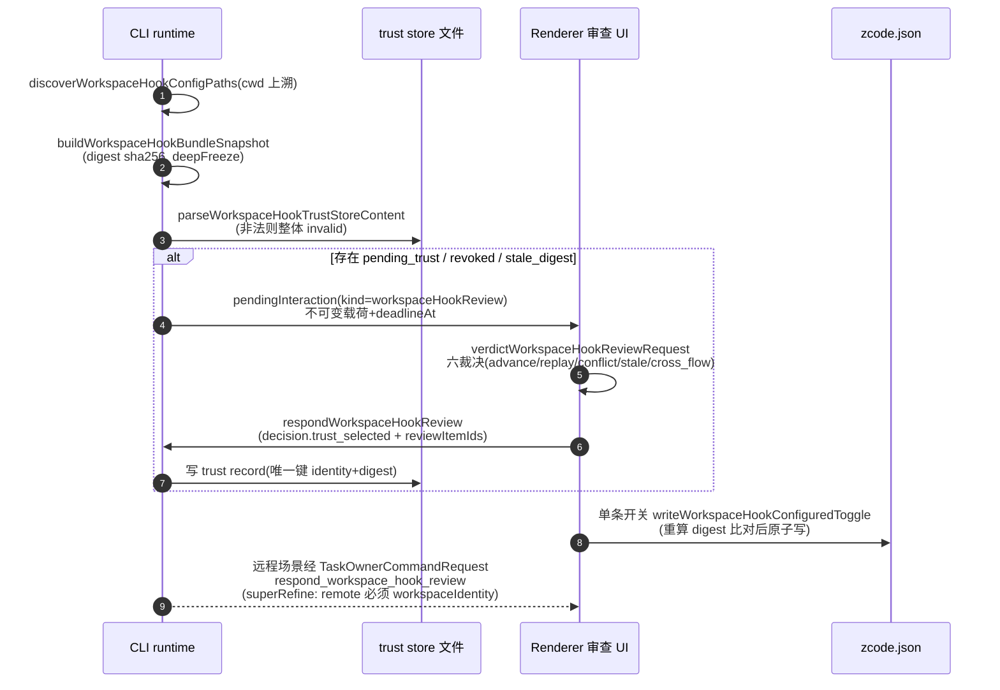
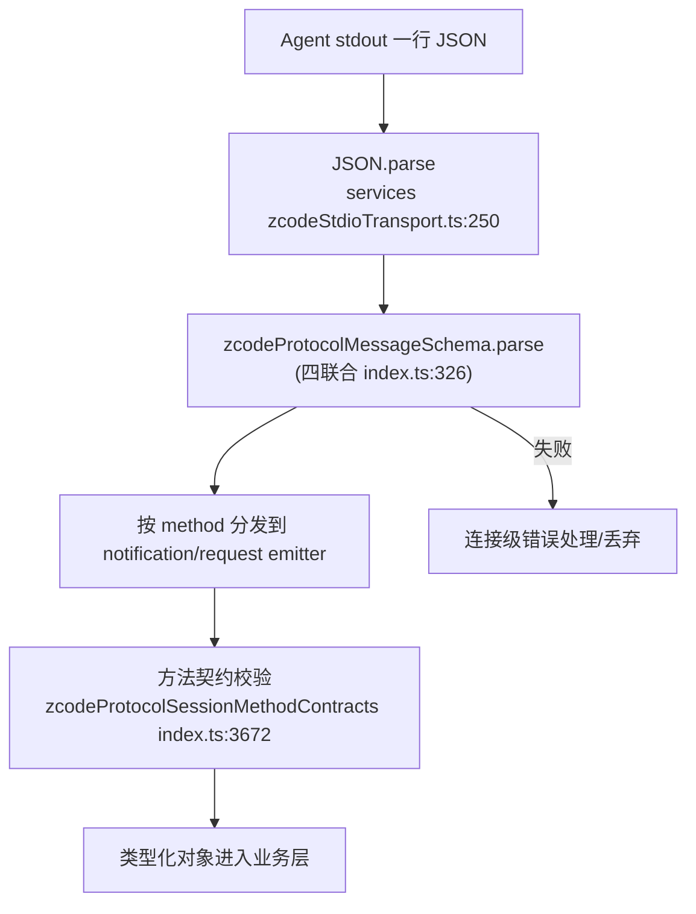

# packages/shared — 共享协议与类型（函数级）

216 个 ts 文件；运行时依赖仅 `zod@4.6.5` + `@zcode/model-option-map`。定位：五端（desktop/web/services/ui/cli）共用的「协议 + 类型 + 纯函数」单一来源。纪律：`zcode-protocol-v4` 只允许 schema + 纯函数，禁止运行时/IO/传输（`zcode-protocol-v4/core.ts:2`）；例外是 workspace-hook 子族依赖 node:fs/crypto，经独立 subpath 暴露。

## 1. 模块地图（按领域）

| 分组 | 关键文件（src/） | 职责 |
| --- | --- | --- |
| 协议层 | `zcode-protocol/index.ts`(3717 行)、`zcode-protocol-legacy-types.ts`、`zcode-protocol-v4/`(47 文件)、`handshake.ts`、`task-realtime(-core).ts`、`channels.ts`(1149 行)、`api.ts` | JSON-RPC 帧、方法词表、V4 全套、频道名总表 |
| 任务/会话投影 | `zcode-task-types-core.ts`(1187 行)、`zcode-task-types.ts`、`zcode-session-task-status.ts`、`zcodePersistedMessageMerge.ts`、`execution-state.ts`、`background-task-*.ts`、`automation-types.ts`、`off-peak-types.ts` | 任务元数据、流事件、持久化消息、定时/闲时任务 |
| 模型/Provider | `model-selection.ts`、`model-config.ts`、`model-provider-types.ts`、`provider-provisioning.ts`、`oauth.ts`、`coding-plan-subscription.ts`、`usage-quota.ts` 等 | 模型选择编解码、provider id 判定、订阅/配额 |
| 插件/Skills/Subagents/MCP | `plugin-types.ts`、`plugin-marketplaces.ts`、`plugin-sync.ts`、`skills-types.ts`、`skill-sync.ts`、`subagents-types.ts`、`mcp.ts`、`mcp-sync.ts`、`official-mcp-auth.ts` | manifest 摘要、官方市场、同步类型 |
| 远程工作区 | `remoteTarget.ts`、`remote-workspace-identity.ts`、`remoteEnvironmentKey.ts`、`remoteSshHostKey.ts`、`remoteAssetInstallMode.ts`、`remoteResourcePackages.ts`、`remote-sync.ts`、`wslUserValidation.ts`、`intranetProbe.ts` | SSH/WSL/Docker 目标判别联合、身份构造解析、资产包 |
| Workspace Hook | `workspace-hook-config/digest/discovery/mutation/review-monotonicity/trust-store-file.ts`、`hooks.ts` | 发现、摘要、原子变更、审查单调性、信任存储 |
| 平台/桌面 | `platform.ts`(970 行, IPlatformService)、`desktopMenu.ts`、`update.ts`、`forceUpdate.ts`、`process-names.ts`、`browser-use/`(7 文件) | 平台抽象、菜单、更新、进程命名 |
| 设置/校验 | `validation.ts`(1252 行)、`validationAppSettings.ts`、`config-schema.ts`、`settings-source/errors/sync.ts`、`storage.ts`、`git.ts`、`env.ts`、`runtimeEnv.ts`、`zcodeEndpoint.ts` | host↔main 消息 schema 汇聚、设置 schema |

## 2. 核心数据结构

### 2.1 旧协议（v3）JSON-RPC 帧 — `zcode-protocol/index.ts`

| Schema | 行 | 结构 |
| --- | --- | --- |
| `zcodeProtocolRequestSchema` | :285 | `{id, method, params?, trace?}` `.strict()` |
| `zcodeProtocolNotificationSchema` | :295 | `{method, params?, trace?}` |
| `zcodeProtocolResponseSchema` | :304 | `{id, result}` |
| `zcodeProtocolErrorSchema` | :312 | `{id, error{code,message,data?}}` |
| `zcodeProtocolMessageSchema` | :326 | 四者 `z.union` |
| `zcodeProtocolMethods` | :3560-3664 | ~60 方法词表（session/create、resume、list、send、plugins/*、automation/*、offPeak/*、interaction/*）；多个已标 `@deprecated` 收敛 v4 |
| `zcodeProtocolSessionMethodContracts` | :3672 | 存活契约仅 4 个（workspaceHookTrustGrant / mcpList / interactionBrowserList / interactionBrowserExecute） |

常量：`ZCODE_PROTOCOL_VERSION=1`(:73)、`ZCODE_PROTOCOL_V4_WIRE_VERSION=3`(:75)、`zcodeProtocolErrorCodes.sessionUnavailable=-32004`(:79)。

### 2.2 V4 wire 层 — `zcode-protocol-v4/`

| 结构 | 行 | 说明 |
| --- | --- | --- |
| `DELIVERY_PROFILES` | `core.ts:34` | continuous 30ms flush / replayable 150ms + toolProgress |
| `PROTOCOL_V4_LIMITS` | `core.ts:64` | ~35 项限额：maxFrameBytes 1MiB、logicalFrameAssemblyMaxBytes 16MiB、attachmentChunkMaxBytes 512KiB、attachmentMaxBytes 20MiB… |
| `TopicWireFrame<F>` | `wire.ts:19` | `kind:"complete"`（内嵌）或 `kind:"fragment"`（fragmentIndex/Count/checksum crc32/dataBase64） |
| `topicWireFrameCandidateSchema` | `wire.ts:49` | service 边界只验 outer 路由形状；deliveryKind/frame 故意 `z.unknown()`+passthrough |
| `helloMessageSchema` / `clientHelloSchema` | `transport.ts:35/:62` | connectionId、clientMode、deliveryProfile、capabilities（`workspaceHookReview` 缺省 false 的 wire-compatible 判定 `transport.ts:75/79`） |
| `V4_METHODS` | `transport.ts:307-359` | `v4/connection/flow`、`v4/controller/*`、`v4/conversation/*`(含 rowsRange 分页/attachment/workflowRun*)、`v4/attachment/{begin,chunk,commit,abort,read,previewSource}`、`v4/commands/query`、`v4/command` |
| `V4_NOTIFICATIONS` | `transport.ts:382` | `v4/conversation/frame`、`v4/telemetry/*`、`v4/cua/permission-observation` |

### 2.3 V4 命令层 — `command.ts`(479 行)

- `commandPayloadSchemas`(:43-244)：**33 个命令**——createSession、sendText（superRefine 校验 automationId⊥offPeakTaskId 互斥等，:110）、stop（expectedForegroundExecutionId）、compact、forkAssistant/applyFileRewind/editUserQuery/retryTurn（带 conversationRowTarget）、resolveInteraction、hook 审查四命令（:186-200）、队列五命令、switchModelConfig、switchCollaborationMode（build/edit/plan/yolo）、pauseGoal/resumeGoal、cancelBackgroundWork、resumeWorkflowRun、startSavedWorkflow、renameSession、deleteSession 等。
- `COMMANDS_REQUIRING_BASE_REVISION`(:293)：15 个 CAS 命令必带 baseRevision；`ROW_TARGETING_COMMANDS`(:311) 还需 baseLogEpoch。
- `commandEnvelopeSchema`(:320)：`{commandId(uuidv7), clientId, sessionId, baseRevision?, baseLogEpoch?, type, payload, issuedAt}`。
- `parseCommandEnvelope()`(:337)：信封→按 type 查 payload schema→CAS 约束三段校验。
- `commandAckSchema`(:427)：status ∈ accepted/rejected/stale/duplicate/noop/failed；reasonCode=guard id 或 fault code。

### 2.4 V4 快照与行模型

- `sessionPhaseSchema`(`snapshot.ts:28`)：draft→prewarming→running→completedSuccess|completedInterrupted|error。
- `conversationSnapshotSchema`(`snapshot.ts:469`)：`protocolVersion:1` + sessionId/logEpoch/seq/revision + A 区 ~17 个状态键（control/actionAvailability/inputRouting/queueState/pendingInteraction/backgroundWork/goal/rowsWindow/workspaceHookAdmission）+ B 区 rows；additive 字段全部 `.default()`。
- `conversationRowSchema`(`rows.ts:418`)：判别联合 **9 种行**——turnHeader/userInput/assistantText/reasoning/toolCall/artifact/subagent/hookInvocation/timelineMarker；行基座 `rowBase`(:10) 含 rowId（session 内单调永不复用）与 actions。
- `conversationDeltaSchema`(`delta.ts:53`)：封闭五操作 `row.appended / row.upserted / row.removed / row.delta / state.updated`。

### 2.5 任务类型 — `zcode-task-types-core.ts`

| 结构 | 行 | 要点 |
| --- | --- | --- |
| `ZCodeTaskMeta` | :264 | taskId≡sessionId、workspacePath+workspaceIdentity、mode/model/thoughtLevel/runtimeEpoch、pendingInteraction、lastError(ErrorAttribution) |
| `ZCodeTaskRuntimeStatus` | :163 | idle/creating/notReady/restoring/ready/streaming/completed/failed |
| `ZCodeStreamEvent` | :432 | ~28 种流事件（agent_message_chunk、tool_call、permission_request、elicitation_request、task_complete、usage_update、turn_steer_*…） |
| `ZCodeTaskSnapshot` | :1025 | `ZCodeSessionFile`(meta+messages+fileChanges+turnCheckpoints) + runtime/history/slashCommands/configOptions |

### 2.6 其余关键类型

| 结构 | 位置 | 说明 |
| --- | --- | --- |
| `modelSelectionSchema` | `model-selection.ts:4` | `{providerId, modelId, options.reasoningLevel?}`；picker 值格式 `provider/model$reasoning`（:31-43） |
| `BUILTIN_MODEL_PROVIDER_IDS` | `model-provider-types.ts:7` | 6 个 OAuth provider（zai-{individual,team,start}-coding-plan、bigmodel-*） |
| `InstalledPluginSummary` | `plugin-types.ts:41` | id/marketplace/version/enabled/scope/installPath/hookDetails |
| `DEFAULT_ENABLED_OFFICIAL_PLUGIN_IDS` | `plugin-marketplaces.ts:13` | browser-use、node-repl-host 等 10 个官方默认启用 |
| `buildRemoteWorkspaceIdentity()` | `remote-workspace-identity.ts:46` | `remote:ssh:<host>:<port>:<user>:<path>`、`remote:wsl:<distro>[:<user>]:<path>`、`remote:docker:<container>:<path>`；对偶 `parseRemoteWorkspaceIdentity()`(:68) |
| `resolveWorkspaceKey()` | `task-realtime-core.ts:78` | **`workspaceIdentity?.trim() \|\| workspacePath` 规范实现**（唯一定义点） |
| `zcodeWorkspaceRefSchema` | `zcode-protocol-legacy-types.ts:34` | `{workspacePath, workspaceIdentity?, remoteSessionId?, workspaceKey}` |
| `workspaceHookReviewRequestPayloadSchema` | `v4/workspace-hook-review.ts:79` | 不可变载荷：reviewFlowId/generation/bundleDigest/items[]/deadlineAt；superRefine 校验 summary 计数一致（:140-178） |
| `workspaceHookTrustRecordSchema` | `workspace-hook-trust-store-file.ts:37` | `(workspaceIdentity, hookDeclarationDigest)` 唯一键 + 授权时刻快照字段 |

## 3. 运行时校验机制

全 zod 4，四层风格：`.strict()` 默认（例外刻意标注：`statePatchSchema` 不 strict，保 additive 演进，`delta.ts:43-44` 注释）→ `z.discriminatedUnion`（事件/op/kind）→ `superRefine` 跨字段不变量（CAS 约束 `command.ts:337-359`、workspaceKey 匹配 `task-realtime-core.ts:126-138`、base64 字节上限手写解码器 `transport.ts:851-870`）→ V4 两阶段校验（outer 路由 → ownership 后全量，失败产 typed fault 而非静默 drop，`wire.ts:54-62`）。

## 4. 运行时类（仅 4 个）

| 类 | 位置 | 职责 |
| --- | --- | --- |
| `TopicWireFrameAssembler<F>` | `wire-assembler.ts:143` | V4 分片装配状态机：`assemblies: Map<routeKey, FragmentAssembly>`、settledByRoute 单调 tombstone、stagedBytes 记账；约束 ≤32 并发/32MiB/30s 超时（`core.ts:66-70`）；输出 complete 或 fault{reasonCode} |
| `TopicWireFrameEncodingError` | `wire-codec.ts:87` | 编码侧 fail-closed 错误（`proto.frameAssemblyTooLarge` 等） |
| `WorkspaceHookMutationError` | `workspace-hook-mutation.ts:14` | 四错误码（snapshot_mismatch/bundle_changed/config_unreadable/config_write_failed） |
| `ApiError` | `api.ts:18` | HTTP 客户端错误基类 |

## 5. 关键函数调用链

### 链 1：V4 下行帧（编码→装配→应用）

```
CLI: encodeTopicWireFrames [wire-codec.ts:169]
  → measureTopicNotificationEnvelopeBytes [:25, 三层计量]
  → findFragmentByteBudget 二分 [:137]
  → service 边界: topicWireFrameCandidateSchema.safeParse [wire.ts:49]
  → TopicWireFrameAssembler 接纳分片 [wire-assembler.ts:143]
      → decodeWireBase64 / crc32WireBytes [wire-binary.ts:20/32]
      → reassembleTopicWireFrames [wire-reassembly.ts:30]（长度/重复片/checksum/UTF-8/JSON/frameSchema）
  → 客户端: applyConversationDeltas [apply.ts:125]
      → applyConversationDelta [:67] 五分支
      → appendToRow [:38] 按 StreamablePath 分派
```

服务端冷恢复优化：`createMutableConversationSnapshotAccumulator`(`apply.ts:23`) + `applyConversationDeltaMutable`(:140)，O(N²)→O(N)。

### 链 2：workspace hook 发现→信任→审查

```
discoverWorkspaceHookConfigPaths [workspace-hook-config.ts:207]
  → getProjectConfigDirectories [:335, cwd 向上至 worktree 根]
  → buildWorkspaceHookCandidatePaths [:174, 每目录 zcode.json + .zcode/config.json]
  → deduplicateWorkspaceHookConfigRefs [:193, resolve 去重保序]
resolveWorkspaceHookEntries [workspace-hook-digest.ts:62]
  → resolveWorkspaceHookTimeoutMs [config.ts:113, 默认 60s]
  → createWorkspaceHookDeclarationDigest [digest.ts:192 → sha256]
  → buildWorkspaceHookBundleSnapshot [:135] → bundleDigest
parseWorkspaceHookTrustStoreContent [trust-store-file.ts:87]（非法整体 invalid）
verdictWorkspaceHookReviewRequest [review-monotonicity.ts:36]
  六裁决: no_current/same_flow_advance/replay/conflict/stale/cross_flow
writeWorkspaceHookConfiguredToggle [mutation.ts:61]
  → 重算 digest 比对（declaration changed 守卫 :123-136）
  → atomicWriteWorkspaceHookConfig [:33, temp+fsync+rename]
```

## 6. 关键流程图

### 6.1 hook 审查全流程



### 6.2 协议 JSON → 类型化对象（旧协议）



## 7. 依赖与暴露面

- 被依赖：web、provider-node、client、desktop、provider、services、server、ui、zcode-server-cli + apps/zcode-cli（contracts 直接 import）。
- 暴露：主 barrel `.` + 13 个 subpath（zcode-protocol-v4、node、model-selection、workspace-hook-discovery/-mutation/-review-monotonicity/-trust-store-file 等）；discovery barrel 刻意不 re-export mutation/monotonicity（「一个 API 恰好一条暴露路径」，`workspace-hook-discovery.ts:1-4`）。

## 8. 深读/采样说明

深读（逐行/近全文）：zcode-protocol-v4 的 20/47 主链文件（core/wire/wire-codec/wire-reassembly/transport/command/rows/snapshot/delta/apply/…）、zcode-protocol/index.ts 头尾段+方法词表、handshake、task-realtime(-core)、remote-workspace-identity、workspace-hook 全 6 文件、platform.ts 全文、channels.ts 频道表、model-selection、plugin-types、zcode-task-types-core 全文等。采样（outline/名称索引）：v4 的 workflow-* 10 文件、根目录约 60 个外围文件、node/ 与 browser-use/ 目录。
