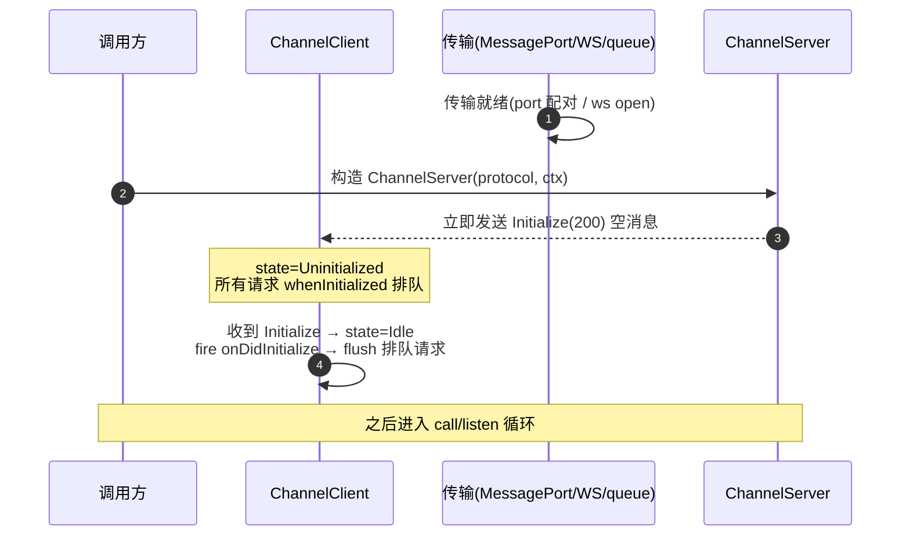
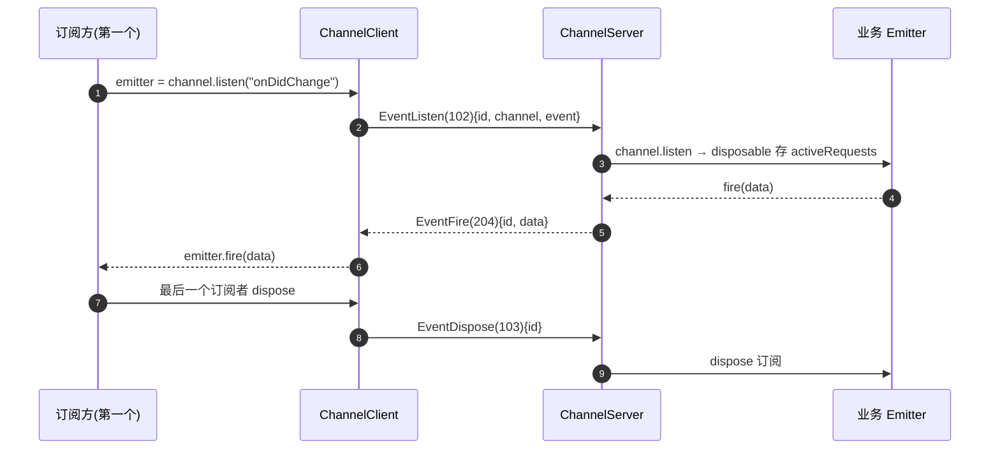
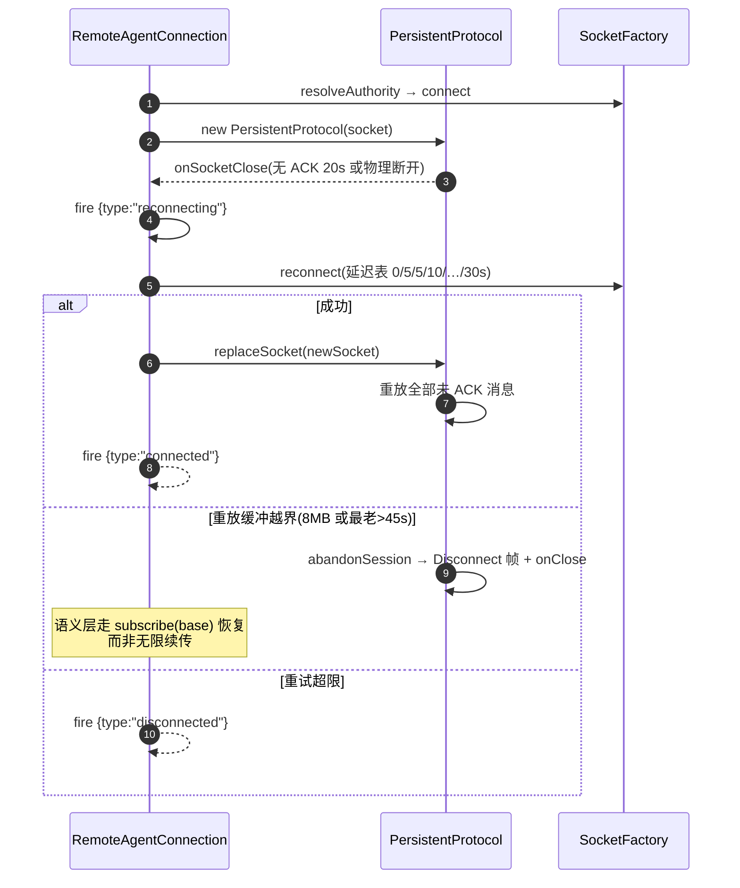

# packages/rpc + packages/client — IPC 框架与客户端 SDK（函数级）

`@zcode/rpc`：15 个 src 文件，自述 "VS Code style IPC communication abstraction framework"（`packages/rpc/package.json:4`）。`@zcode/client`：6 个文件，把 RPC 封装为 Agent 客户端 SDK。

## 1. rpc 分层结构（`src/index.ts:1-29` 官方分层）

| 层 | 文件 | 职责 |
| --- | --- | --- |
| L0 | `foundation.ts:14-260` | Event/Emitter/Relay/EventMultiplexer/DisposableStore/CancellationToken |
| L0.5 | `buffer.ts:10-88` | VSBuffer：Uint8Array 薄封装，统一二进制读写 |
| L1 | `serialization.ts:152-218` | 自定义二进制序列化：类型标签 + VQL 变长整数 + JSON fallback |
| L2 | `protocol.ts` / `persistent-protocol.ts` | `IMessagePassingProtocol` 抽象；13 字节帧分帧；ACK/心跳/重放 |
| L3 | `channels.shared.ts` / `channelServer.ts` / `channelClient.ts` | Channel RPC（call/listen） |
| L4 | `ipc.ts` | IPCServer(1:N 路由/多播)、IPCClient(1:1)、StaticRouter |
| L5 | `proxy-channel.ts` | `fromService`/`toService` ES6 Proxy 自动代理 |
| L6 | `remote.ts` | Remote authority、SocketFactory、RemoteAgentConnection 重连 |
| 中间件 | `logging-middleware.ts`、`network-telemetry-middleware.ts` | 调用日志与 ARMS 网络遥测装饰 |

## 2. 核心数据结构

### 2.1 传输抽象

```ts
// protocol.ts:24-28
interface IMessagePassingProtocol {
  send(buffer: VSBuffer): void;
  readonly onMessage: Event<VSBuffer>;
  drain?(): Promise<void>;
}
```

四种传输实现：内存队列对（`createQueuePair`，`protocol.ts:318-339`，测试用）、MessagePort（免分帧 + 流控控制帧 `{__zcodeRpcControl:"connection-flow-v1"}`，`protocol.ts:361-397`）、Socket 流式（TCP/WS/stdio，`protocol.ts:236-307`）、PersistentProtocol 可靠性层（`persistent-protocol.ts:46`）。`ISocket`(`protocol.ts:68-75`) 抽象底层 socket；`wrapBrowserWebSocket`（client `websocket.ts:23-60`）把浏览器 WebSocket 适配为 ISocket。

### 2.2 帧格式

传输帧（仅流式）13 字节头：`type(1) + id(4) + ack(4) + length(4)`（`protocol.ts:184-207`）；`ProtocolMessageType`：Regular=1/Control=2/Ack=3/Disconnect=5/ReplayRequest=6/Pause=7/Resume=8/KeepAlive=9（:195-205）。

Channel RPC 消息（payload 内部，自定义二进制非 JSON-RPC）：

| 枚举 | 值 | 用途 |
| --- | --- | --- |
| RequestType: Promise / PromiseCancel / EventListen / EventDispose | 100/101/102/103 | 请求/取消/事件订阅/退订（`channels.shared.ts:18-31`） |
| ResponseType: Initialize / PromiseSuccess / PromiseError / PromiseErrorObj / EventFire | 200-204 | 初始化/成功/错误/错误对象/事件 |

序列化：`[1 字节类型标签][VQL 长度][数据]`（`serialization.ts:152-218`）；VQL = MIDI 式变长整数（:67-103）；嵌套 Uint8Array 在 JSON fallback 中以 `{__zcode_rpc_nested_uint8array_v1:{base64}}` 往返（:136,220-250）。

### 2.3 核心类

| 类 | 内部状态 | 关键方法 |
| --- | --- | --- |
| `ChannelClient`（`channelClient.ts:19-35`） | `handlers: Map<id,IHandler>`（Promise 与事件监听共用递增 id 空间）、`pendingRejections`、`lastRequestId` | getChannel / requestPromise(:60-127) / requestEvent(:149-176 懒订阅) / dispose(:249-274 fail-closed) |
| `ChannelServer<TContext>`（`channelServer.ts:14-19`） | `channels`、`activeRequests`、`pendingRequests`（未知 channel 暂存 1s，:229-273） | registerChannel / ready / onPromise(:100-191) / onEventListen(:193-218) |
| `IPCServer<TContext>`（`ipc.ts:95-111`） | `_connections`、多播事件 | getChannel(name, router) / registerChannel / getMulticastEvent(:213-245) |
| `PersistentProtocol`（`persistent-protocol.ts:63-96`） | `outgoingUnackMsg[]`、`unackBytes`、`incomingAckId`、`saturated` | send / replaceSocket(:149-160 重放) / abandonSession(:240-249) |
| `RemoteAgentConnection`（`remote.ts:263-274`） | protocol + client | connect / reconnect（延迟表 `[0,5,5,10,10,10,10,10,30]`s，:247） |

## 3. 请求-响应关联机制

- id 关联：`lastRequestId++` 注册 handler，响应 `onBuffer → deserialize → handlers.get(response.id)?.(response)`（`channelClient.ts:209-240`）。
- **无客户端侧超时**；超时只在：server 未知 channel 1000ms（`channelServer.ts:25`）、PersistentProtocol ACK 20s（`persistent-protocol.ts:81`）。
- 事件懒订阅：首个订阅者发 `EventListen(102)`，最后离开发 `EventDispose(103)`（`channelClient.ts:149-176`）；服务端 `fromService` 的 bufferEvent 无人订阅时入队缓存，首订阅者到达 flush（`proxy-channel.ts:178-213`）。

## 4. 关键函数调用链

### 链 A：一次 RPC 调用（proxy → 传输 → 对端 → resolve）

```
RemoteServiceAccess 构造: ProxyChannel.toService<IFileService>(channelClient.getChannel(IFileService.channelName))
  [client/src/remoteServiceAccess.ts:95-97; channelName 来自 services descriptors.ts:14-16]
→ 调 fileService.readFile(path) → Proxy get 拦截 → channel.call(propKey, args) [proxy-channel.ts:136-140]
→ requestPromise(channelName, command, arg, ct) [channelClient.ts:39-44,60-127]
→ sendRequest: serialize([type,id,channel,name]) + serialize(arg) → protocol.send [channelClient.ts:178-193]
→ SocketProtocol.send → writeProtocolMessage(Regular,0,0,buffer) → socket.write [protocol.ts:222-258]
（对端）socket.onData → ChunkStream.acceptChunk → readMessages（整帧到齐才消费 header）[protocol.ts:260-297]
→ ChannelServer.onRawMessage → onPromise → channel.call(ctx,name,arg,token) [channelServer.ts:68-191]
→ sendResponse(PromiseSuccess) → 客户端 handlers.get(id) → resolve(response.data)
```

### 链 B：一次事件（fire → 订阅回调）

```
服务端业务 Emitter.fire
→ ProxyChannel.fromService.listen（缓存/buffer 事件）[proxy-channel.ts:62-83]
→ ChannelServer.onEventListen → sendResponse(EventFire) [channelServer.ts:206-217]
→ 客户端 onResponse → handlers.get(id) → emitter.fire(data) [channelClient.ts:171-173]
→ （多播场景）IPCServer.getMulticastEvent 经 EventMultiplexer 聚合 [ipc.ts:213-245]
```

## 5. 关键流程图

### 5.1 连接建立与初始化握手



（IPCServer 场景：客户端第一条消息是序列化 ctx 身份，服务端 `Event.once` 读取后才建 server/client 并回放已注册 channels，`ipc.ts:117-147`。）

### 5.2 事件订阅生命周期（懒订阅）



### 5.3 断线重连（RemoteAgentConnection + PersistentProtocol）



## 6. 错误传播路径

| 场景 | 路径 |
| --- | --- |
| 服务端抛 Error | `onPromise` catch → `{message,name,stack,code,kind,status,retryAfterMs,data,…}` 以 PromiseError(202) 回传（`channelServer.ts:134-177`，passthrough 键双侧对称 `channelClient.ts:91-107`）→ 客户端重建 Error reject，name/stack 还原 |
| 非 Error 值 | PromiseErrorObj(203) 原样 reject |
| 序列化失败 | 发送侧 try-catch 静默吞（`channelClient.ts:188-192`）；反序列化未知标签返回 undefined |
| 客户端取消 | PromiseCancel(101) + 本地立即 reject("Cancelled")（`channelClient.ts:129-137`） |
| 连接终结 | `dispose(reason)` 把 pendingRejections 全部 fail-closed reject（防 workspace key 永久占用，`channelClient.ts:249-274`） |
| 网络错误分类 | `classifyErrorKind`（timeout/dns_failure/connection_reset/other）上报 ARMS（`network-telemetry-middleware.ts:37-54`） |

## 7. packages/client（Agent 客户端 SDK）

- 三种入口：`connectViaWebSocket(wsUrl)`（`websocket.ts:62-105`）、`connectViaMessagePort(port)`、`connectViaProtocol(protocol)`。
- 核心 `RemoteServiceAccess`：把 ~40 个 services 接口一把梭成类型安全代理；可选 provider（provisioning target）定义为 non-enumerable 防泄漏给 renderer（`remoteServiceAccess.ts:73-74,157-162`）。
- `createMessagePortServiceConnection(port)` 显式生命周期：dispose 先 fail-closed pending 再关 port（`messageport.ts:25-49`，scoped remote session 换代必须同时释放两者）。
- client 包自身不重连；重连职责在 rpc 的 RemoteAgentConnection。

## 8. 深读/采样说明

rpc 15 个 src 文件 + examples/01 全部深读；client 6 文件全读。未读：rpc examples/02-04（行为已被对应源文件覆盖）。
