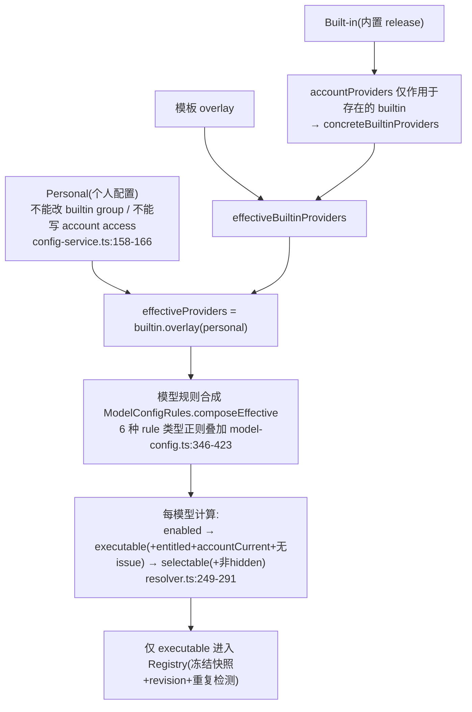
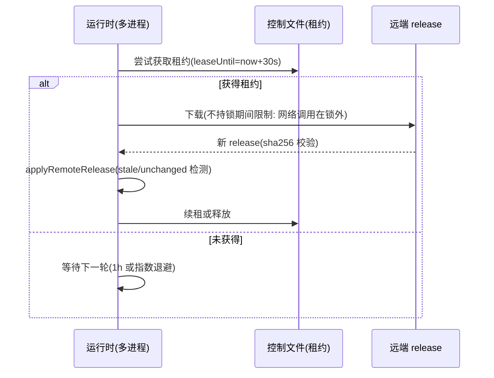
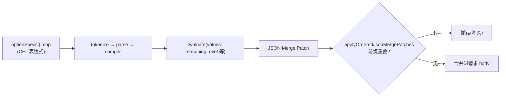

# packages/provider(-node) + model-option-map + formal-proof + zcode-cua（函数级）

## 1. 模块职责

| 包 | 规模 | 职责 |
| --- | --- | --- |
| `@zcode/provider` | 23 文件 | 纯领域层（无 IO）：Provider/Model 配置 Overlay 模型、zod schema、三层合成、Registry 快照、Settings/Selection Facade |
| `@zcode/provider-node` | 17 文件 | Node 端：文件持久化（原子写+锁+轮询）、内置 Release 下载/远端同步（租约）、Endpoint 隔离缓存、运行时组装 |
| `@zcode/model-option-map` | 8 文件 | 受限 CEL 子语言：`reasoningLevel/maxOutputTokens` → JSON Merge Patch |
| `@zcode/formal-proof` | 3 文件 | 会话状态空间形式化模型 + d3 可视化（可执行裁决表） |
| `@zcode/zcode-cua` | 12 对 d.ts/js | API 兼容占位包，全部 fail-closed |

## 2. provider 核心抽象

### 2.1 数据结构

```ts
// resolver.ts:168-172 / provider-data-schema.ts:4-99
interface Provider { providerId; providerName; templateId?; config: RegistryProviderConfig; models: ProviderModel[] }
// RegistryProviderConfig = access(api-key | zhipu-account 判别联合)
//                      + api(type: anthropic-messages|openai-chat-completions|openai-responses, baseUrl, headers)
//                      + builtinModelIds/personalModelIds/modelOrder/visibility
```

### 2.2 三层配置合成（`resolver.ts:183-343`）



### 2.3 关键类

| 类 | 位置 | 要点 |
| --- | --- | --- |
| `ProviderRegistry` | `registry.ts:47-126` | 冻结快照 + revision；重复 provider/model 检测 |
| `ProviderRegistryService` | `registry-service.ts:53-255` | generation 化刷新循环（requested/completed/waiters）；**Account revision 落后 builtin 时继续服务上一份 Registry**（:205-212） |
| `AccountProviderService` | `account-provider-service.ts:45-240` | 注入式 resolver；失败 fail-closed 快照（所有 zhipu-account provider 标 entitled:false，`sources.ts:34-53`） |

## 3. provider-node（Node 端实现）

| 组件 | 位置 | 机制 |
| --- | --- | --- |
| `NodeProviderConfigRuntime` | `provider-config-runtime.ts:41-171` | builtin source + personal repo + config service；60s unref 定时后台检查 |
| `NodeProviderRegistryRuntime` | `provider-registry-runtime.ts:21-74` | 再加 RegistryService；account source 初始 fail-closed |
| `NodePersonalProviderConfigRepository` | `personal-provider-config-repository.ts:28-227` | 文件锁内 read-transform-atomicWrite；revision=内容 sha256；1s 轮询跨进程变更 + writeGeneration 防自写回声（:190-217）；损坏文件保留原样仅内存降级（:159-164） |
| `NodeZCodeBuiltinProviderConfigSource` | `zcode-builtin-provider-config-source.ts:23-232` | Bundled(随包可信基线) vs Active(LKG 缓存) 双候选；fs.watch；`applyRemoteRelease` 带 stale/unchanged/同 revision 不同内容检测（:64-84） |
| `ZCodeBuiltinRemoteSynchronizer` | `zcode-builtin-remote-synchronizer.ts:49-169` | 控制文件租约（leaseUntil 30s）合并多进程刷新；成功间隔 1h、失败指数退避 60s×2ⁿ 封顶 1h；网络期间不持锁 |

`downloadZCodeBuiltinRelease`（`zcode-builtin-download.ts:35-128`）安全边界：20s 总预算、HTTPS-only、10MB 上限、`credentials:"omit"`、`redirect:"error"`、错误信息不带 URL/正文。缓存路径按 `platform/appVersion/sha256(endpointOrigin 前32hex)` 隔离（`zcode-builtin-cache-paths.ts:24-59`）。

### 远端同步租约流程



## 4. model-option-map（受限 CEL）

流水线：`tokenizeRestrictedCel`（`tokenizer.ts:22-73`，仅 identifier/string/number/operator/punctuation）→ `parseRestrictedCel`（`parser.ts:46-240`，递归下降 conditional→||→&&→==!=→关系→+-→*/%→一元→primary；**禁止成员访问与函数调用** :65-70,158-161）→ `evaluateRestrictedCel`（`evaluator.ts:9-215`，强类型 + JSON-safe 数字断言 + 深度冻结）→ `compileRestrictedCel/compileModelOptionMap`（`compiler.ts:17-57`，Map 缓存）。

`compileModelOptionMaps(specs).apply(body, values)`（`option-maps.ts:20-34`）：两选项各产 patch，`applyOrderedJsonMergePatches` 检测写路径前缀重叠冲突即抛错（`merge-patch.ts:13-57`），null 删键（RFC 7386）。



## 5. formal-proof 与 zcode-cua

- formal-proof：`ProductContext` 7 维（runPhase/queue/compactMemory/canCompactAgain/goal/selectedTurn/forked，`model.ts:12-20`）；`Decision{kind: allow/reject/enqueue/choice/system/undefined}`(:30-37)；`buildTraceTree` BFS 展开 + 环检测（:358-364）；`evaluate()`(:486-504) 被 CLI 投影当「可执行裁决表」使用，由 `formal-proof-consistency` 黄金测试背书。
- zcode-cua：`createComputerUseRuntime` 恒返回 `{content:[{type:"text",text:"Computer Use is not available in this build."}],isError:true}`（`index.js:3-14`）；`callBrokerMethod` 恒抛 BrokerError（`broker.js:39-41`）。

## 6. @ai-sdk patch 的用途

根 `package.json:87-91` 三个 patch：`@ai-sdk/anthropic@3.0.81`（新增 video/* file part → Anthropic 风格 `{type:"video",source:{type:"base64"}}` content block，供兼容网关）、`@ai-sdk/openai-compatible@2.0.60`（video/* → `video_url` data URL part）、`@arms/rum-electron`（logger 多参修复 + api-key/bearer 脱敏 + 2000 字符截断）。provider 包本身不依赖 @ai-sdk —— 它只产出模型能力/档位配置，请求体定制经 model-option-map 在上层完成。

## 7. 深读/采样说明

rpc 级全读：provider 21/23 文件、provider-node 全 17、model-option-map 全 8、formal-proof 的 model.ts/main.ts、zcode-cua 全部类型与实现桩；schema 文件读前 120-150 行（定义已覆盖关键联合）。未读：examples（rpc 包）与 3 个微型桩文件。
