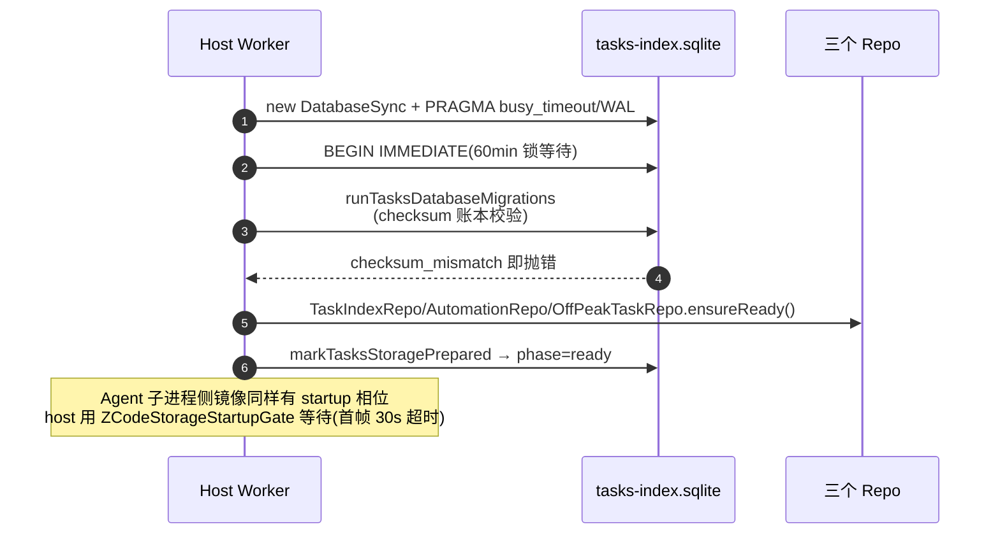
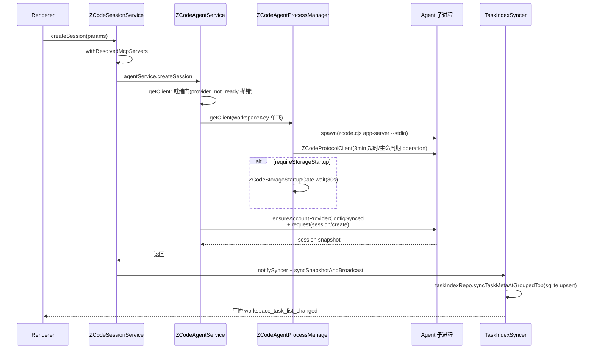
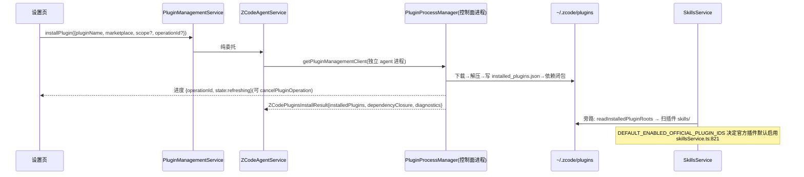
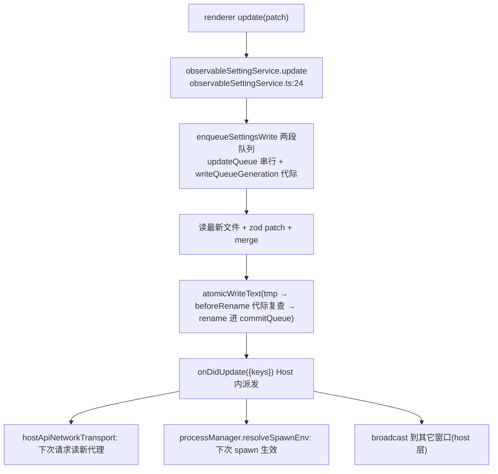

# packages/services — Host 业务服务层（函数级）

298 个 ts 文件。所有服务经 `ServiceDescriptor`（channel 名 + phantom 类型）注册进 `ServiceCollection`，`exposeOnChannelServer` 自动暴露为 RPC channel（`collection.ts:12-41`）。根入口 `index.ts` browser-safe，Node 装配统一在 `node.ts` 的 `createLocalServices()`（`node.ts:1281` 起，注册清单 :2423-2596）。

## 1. 服务清单（按领域）

| 领域 | 服务（接口） | 入口 |
| --- | --- | --- |
| 会话/任务 | IZCodeSessionService（app 门面）、IZCodeAgentService（协议全量面，863 行接口）、IZCodeTaskService（adapter）、AutomationService、OffPeakTaskService、IConversationShareService | `zcode-session/zcodeSession.ts:135-160`、`zcode-agent/zcodeAgent.ts`、`session/zcodeTaskService.ts:198-237` |
| 会话仓库 | TaskIndexRepo(2567 行)/AutomationRepo/OffPeakTaskRepo 共用 tasks-index.sqlite | `session/taskIndexRepo.ts:481` |
| 存储 | IStorageService（设置页存储管理，唯一 managed 模块） | `storage/contract.ts:31-35` |
| 插件/技能 | IPluginsService（已退役，全部抛 retired）、IPluginManagementService（纯转发）、IPluginSyncService、ISkillsService、ISkillSyncService、IMcpSyncService、ISubagentsService、ICommandsService、IHooksService | `plugins/pluginsService.ts:17-19`、`skills/skillsService.ts` |
| Git/文件 | IGitService(19 方法)、IGitCheckpointService、IFileService、IFileWatcherService、IMemoryService、ISettingsSyncService、IFeedbackService | `git/git.ts:32-52`、`file/file.ts:21` |
| 终端/进程 | ITerminalService(node-pty 懒加载)、process 树终止/采样、ISystemService、ICuaPermissionService、IWindowControllerService | `terminal/terminalService.ts:28-43`、`process/processTreeTerminator.ts:403` |
| 模型/账号 | IOAuthService、ICredentialService、IProviderSettingsService、IModelSelectionService、ICodingPlanSubscriptionService、IUsageStatsService、bigmodel/* | `oauth/oauthService.ts:117`、`credential/credentialService.ts:87-130` |
| 遥测/配置 | IBroadcastService（跨窗口广播+分布式 claim）、conversation-telemetry、telemetry、device、IClientConfigService、IClientScenesService、IOnboardingRecordService | `broadcast/broadcast.ts:37-50` |

## 2. 持久化双轨

### 2.1 JSON 文件轨（设置/凭据）

- `setting.json`：读路径先 `await updateQueue` 防越过在途写（`settingService.ts:265-267`）；解析失败短重试 3×300ms → 隔离 `.corrupt-{ts}` → 回默认（:72-94）。写路径**两段队列**：updateQueue 串行 + writeQueueGeneration 代际使旧写在 `beforeRename` 前丢弃（:288-306）；patch zod → merge（防 recentProjects 互相抹掉 :352-356）→ `atomicWriteText`（tmp→rename 进 commitQueue）。
- `credentials.json`：值加密（credentialCipherProvider，预留 Electron safeStorage）+ `withFileLock` 覆盖整个 read-modify-write（desktop host 与 CLI 是独立进程，:109-111）+ 损坏拒绝自动覆盖（:62-72）+ `onDidMutate` 通知 provisioning 镜像（`node.ts:1401-1407`）。

### 2.2 SQLite 轨（tasks-index）

- `node:sqlite DatabaseSync`（经 `createRequire` 防 bundler 改写，`startup.ts:6-8`），WAL + busy_timeout + foreign_keys（`taskIndexRepo.ts:527-530`）。三表族：tasks / automations / automation_runs / off_peak_tasks（`schema-v1.ts`）。
- 迁移：冻结账本 `tasks_schema_migration(id, checksum, time_applied)`；checksum=SHA256(JSON(冻结列声明))（禁 function.toString 哈希——Electron 打包会改变函数文本，`migrations.ts:44-45`）；不匹配抛 `checksum_mismatch`。
- 启动相位机：`checking→waiting_for_lock→migrating→maintaining→committing→ready`（`startup.ts:21-27`），`BEGIN IMMEDIATE` + 60min 锁等待 + 幂等标记。
- `TaskIndexRepo` 关键签名：`ensureReady()`、`syncTaskMeta({meta,searchableText?})`、`syncTaskMetaAtGroupedTop()`、`applyAgentPatch()`、`queryTaskList()`、`archiveStaleTasks()`；写路径按 workspaceKey 串行化（`writeChains` Map，:489,661）；`rowToMeta` 以标量列覆盖 meta_json 防其他 Host 旧 JSON 覆盖（:218 注释）。

## 3. 会话三层分工

1. **`zcodeSessionService`**（`zcode-session/zcodeSessionService.ts:47`）：app 门面。`createSession()`(:221-273)：sessionTraceId → `withResolvedMcpServers` → agentService.createSession → deferred 草稿注册表（不进 sqlite）/`syncSnapshotAndBroadcast`。`resumeSession()`(:275-350)：导入修复、thoughtLevel 能力校验与 task-local 重放。
2. **`zcodeAgentService`**（`zcode-agent/zcodeAgentService.ts:1051`）：协议面。client 获取三分道：`getClient()`(:3026-3082，复用→并发收敛→provider/model 就绪门→启动)、`getReadOnlyClient(existing-only)`(:3084)、`getPluginManagementClient()`(:3116 **专用控制面进程**)、`getMcpStatusClient()`(:3172 独立 lane 进程)。`createSession()`(:3412-3524)：新旧协议兼容降级重试（旧 strict schema 不识别 thoughtLevel 时重发+事后 setThoughtLevel）。
3. **`ZCodeAgentProcessManager`**（`zcodeAgentProcessManager.ts:538`）：每 workspaceKey 一进程。`startClient()`(:945-1120)：commandResolver → spawn admission（CUA Helper 屏障）→ spawn env → preflight → spawn（detached POSIX 进程组）→ `ZCodeStdioTransport` → `ZCodeProtocolClient` → runtimeIdentity{generation}；代际守卫 :988-999。

## 4. 插件与技能

### 4.1 插件安装（事实源在 zcode-cli Agent 进程）

- IPluginsService 已退役：所有变更方法抛 "Legacy plugin management has been retired in ZCode Agent mode"（`pluginsService.ts:17-19`）。
- IPluginManagementService 是对 `IZCodeAgentService` 18 个 plugins/* 方法的纯委托（文件头注释 :1-4：「插件安装/市场/启停的事实源在 zcode-cli 进程，host 无副本」）。
- agentService 侧（`zcodeAgentService.ts:4095-4240`）：`installPlugin` → `getPluginManagementClient()`（专用控制面进程，避免 plugins 慢握手堵塞串行 stdio 队列）→ `client.request(plugins/install, {workspace, pluginName, marketplace, scope?, dryRun?, operationId?})`；长操作进度 `onDynamicPluginOperationProgress(operationId)`(:1123-1126)。

### 4.2 plugin-sync / skill-sync（跨工作区远端同步）

`pluginSyncService.ts:83-210`：`listLocalUserPluginCandidates`（扫 `~/.zcode/plugins`）→ `listRemoteUserPluginStatuses`（targetExists/samePluginId 判重）→ `exportPluginsArchive`（zip + metadata 通道，50MB 限额）→ `checkRemoteUserPluginWriteAccess`（marker 文件探测）→ `importPluginsArchive`（拒绝 overwrite + 路径逃逸防护 `resolvePluginSyncPathWithin`）。skillSync 同构（20MB 限额）。

### 4.3 skills 本地发现

`skillsService.ts:73-90,140-175`：扫描根 = workspace `.zcode/skills`（向上逐级）+ `.agents/skills` fallback + 用户级 `~/.zcode/skills` + `~/.agents/skills`（同名去重）+ 插件根。遍历器 `walkSkillMarkdownPaths`（`skillDiscoveryWalk.ts:35-50`）：DFS、跳 node_modules/点目录（.system 除外）、限深、realpath 去重防 Windows junction 环路。技能 ID = `provider:scope:name:sha256(path)[0:12]`（:236-242）。

## 5. 设置读写链与广播

## 6. oauth / credential / bigmodel

- `OAuthService`（`oauthService.ts:117`）：`startOAuth`（authorize URL + state）/ `startOAuthWithPolling`（后端 flow：`/api/v1/oauth/cli/poll/{flowId}`，:601-699）/ `handleCallback`（换 token 存凭据）/ `restoreCachedSession(State)`（区分从未登录与 JWT 过期）；JWT 失效广播 `ZCODE_JWT_INVALID_BROADCAST_CHANNEL`。
- `bigmodel`：`teamPlanApiKey.ts:31` 确保 BigModel 团队计划 API key（list→create）；`CodingPlanEntitlement = available / unavailable{reason} / unknown`（`codingPlanEntitlement.ts:29`）。
- 装配链（`node.ts:1392-2596`）：credentialService → accountProviderCredentialStore → accountProviderConfigSource（含 legacy 导入）→ ProviderConfigRuntime → RegistryRuntime → 注册两个 Facade。

## 7. storage 模块（唯一 managed）

三层（`architecture-policy.yaml` 要求 domain→app→adapters）：

| 层 | 组件 | 职责 |
| --- | --- | --- |
| domain | `classifyStoragePath`(`storageCatalog.ts:160-187`)、`CLEANABILITY`(:25-38)、`PROTECTED_BASENAMES`(:136-144)、`createStorageUsageAccumulator`(`usageAggregate.ts:36-87`)、`planStorageClean`(`cleanPlan.ts:26-51`) | 纯函数：路径分类、可清理性、快照折叠（每类 entries 保留 bytes 前 100）、清理计划（logs 不删当天；subagent 24h 活动窗口整组跳过） |
| app | `ports.ts:13-51`（4 端口）、`scanJob.ts:18-104`（AbortController + 进度节流 ≥300ms + 终态必发）、`storageService.ts:24-109`（**不做任何 IO**；jobId 守卫防旧 job 覆盖新快照） | 编排 |
| adapters | `fsWalker.ts:43-142`（有界并发 4、不跟随符号链接、每 256 条 setImmediate、ENOENT 竞态不算错误）等 | IO |

contract（`contract.ts:31-35`）：`IStorageService extends StorageManagementApi` + `onScanProgress` 事件；**不注册为 host RPC 服务**，由 desktop main 持有单例。

## 8. 服务日志 createServiceLogger

`createServiceLogger(scope, {pid?, sink?, isDebugEnabled?})`（`logger/serviceLogger.ts:18-65`）→ `ServiceLogger{debug,info,warn,error(traceId,...args)}`。要点：debug 仅本地开发运行时打印（生产/测试构建不落盘）；traceId 拼进前缀 `[scope][trace:{id}]`。存在理由（:42-44 注释）：服务层日志曾被复用到 ZCode Agent 命名 logger，抽出独立模块使删除 Agent runtime 不牵连其他服务。

## 9. 状态机（host 视角）

| 领域 | 状态与转换 | 位置 |
| --- | --- | --- |
| 插件生命周期 | 未安装→安装中(可 cancel)→已安装→（update/uninstall/restoreBuiltin）；远端判重 exists{targetExists/samePluginId} | 协议词表 + `pluginSyncService.ts:98-121` |
| 任务持久状态 | running/completed/error；`shouldPreserveNewerTerminalStatus` 旧终态保护 | `taskIndexRepo.ts:173-184` |
| 会话运行态投影 | running/waiting/paused→running；error；completed（按 activeTurn/待权限纠偏） | `shared/zcode-session-task-status.ts:9-46` |
| storage 扫描 | scanning→complete/cancelled/failed | `scanJob.ts:3` |
| DB 启动 | checking→waiting_for_lock→migrating→maintaining→committing→ready | `startup.ts:21-27` |
| runtime | available↔unavailable + generation 递增 | `zcodeAgent.ts:182-186` |

## 10. 深读/采样说明

深读：storage 全三层、tasksDatabase、taskIndexRepo 方法区、zcodeSessionService、zcodeAgentService 关键区（client 获取/createSession/插件面）、zcodeAgentProcessManager.startClient、plugins/plugin-sync/skills/skill-sync、settingService 全文、credentialService、collection/descriptors/node.ts 装配区。采样（接口 grep）：git/terminal/process/oauth/bigmodel/model-provider/mcp-sync/settings-sync/memory/hooks/commands/subagents/file/fileWatcher/usage-stats。核心结论：services 是「Host 进程内的装配层」，重业务下沉 zcode-cli，持久化真身在 setting.json/credentials.json 与 tasks-index.sqlite 两处。
