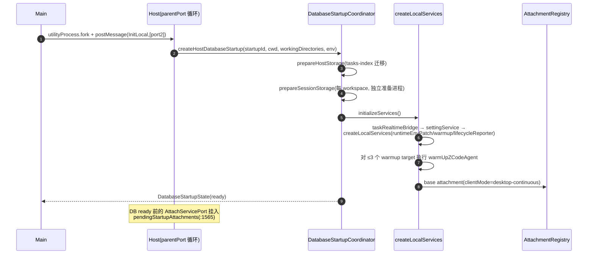
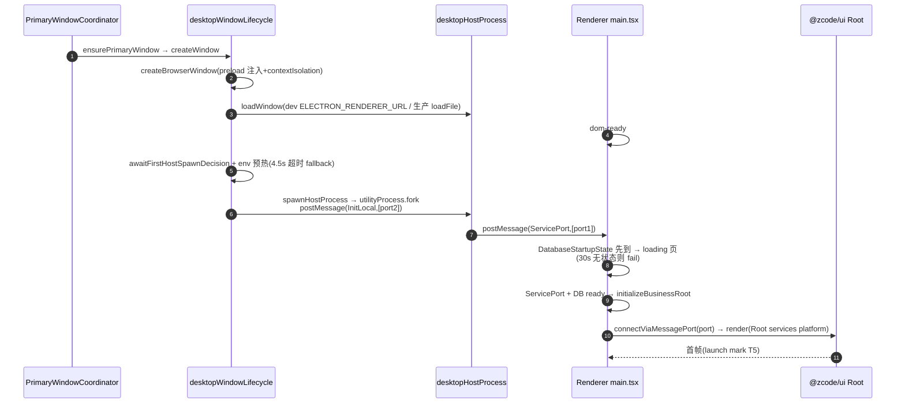
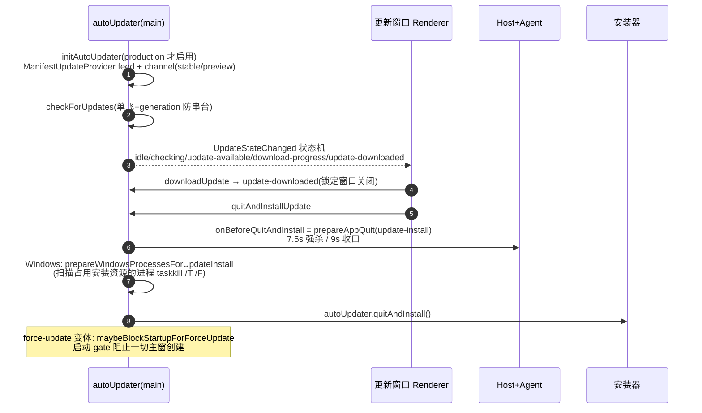

# packages/desktop — Electron 桌面应用（函数级）

265 个 ts 文件。目录：`main/`(~200)、`host/`(~50)、`preload/`(9)、`renderer/`(~15)、`scheduler/`(5)、`shared/`(3)。构建：tsup 产 main/host/preload/scheduler 四 bundle；`bundle` 走 electron-builder。`mock-cdn`（gitignored，`scripts/prepare-prebuilds.mjs:42` 创建）是远程 CDN 的本地镜像，供 SSH/WSL/Docker 远程部署。

## 1. Main 进程启动序列（深读 `src/main/index.ts`，2314 行）

**阶段 0（模块加载期，早于 app ready）**：

1. 早 bootstrap：`desktopEarlyDataBaseDirBootstrap` + Chromium 硬件加速（`index.ts:3-4`）→ 自定义协议 scheme 注册（:251）→ dev 固定 remote-debugging-port 9229（:257-259）→ `app.setName/setPath`（:261-273）。
2. 模块级单例（顺序敏感）：EmbeddedBrowserJavaScriptDialogController（:317-328）→ 截图表面协调器（:333）→ **BrowserGuestManager**（browser-use CDP-on-guest 核心，:339-447）→ BroadcastHub/TaskRealtimeBus（:537-538）→ 登录 shell 环境预热（:603）。
3. 状态表：`windowWorkspaceMap`/`windowHostProcessMap`/`hostRunningTaskCountMap`/`windowUnreadCountMap`（:617-629）。
4. deep link + 单实例锁（:1793-1854）。

**阶段 1（app.whenReady，:1856-2234）**：媒体协议 → **setting.json bootstrap**（dataBaseDir/locale/closeToTray/keepAwake/zoom/窗口尺寸，:1867-1886）→ DB 启动联动（失败即退 app；**scheduler 只在首个 Host DB ready 后拉起**，:1889-1905）→ 菜单/托盘 → **三批 IPC 注册**（platform :1989-2089 / actionTrace :2091 / remote :2098-2124）→ await ARMS → 遥测注册 → 强制升级 gate（:2187-2206）→ `ensurePrimaryWindow("app-ready")`（:2208）。

**阶段 2（dom-ready → Host 拉起）**：见 §3 时序图。

## 2. Host 体系（深读 `src/host/index.ts`，2937 行）

### 2.1 核心组件

| 组件 | 位置 | 职责 |
| --- | --- | --- |
| `activeServices: ServiceCollection` | host/index.ts:1566 | `createLocalServices()`（services/node）装配 |
| `windowHostAttachmentRegistry` | :2068-2092 | `attach({requestId, attachmentId, clientMode, scope, port})`（`windowHostAttachmentRegistry.ts:57-90`）：resolveScope 验证（local→activeServices；remote→按 remoteSessionId 查连接 registry 取 generation/capabilities），**失败即关端口禁止回退本地**；同 attachmentId 旧端口替换 dispose |
| `exposeServicesOnMessagePort` | :1964-2066 | wrapElectronPort → MessagePortProtocol → ChannelServer → Logging/Telemetry 装饰；按 attachment 注入 overrides（controller 路由 taskService、connectionScope 限流 agentService）；流控 `protocol.onFlowState` 转发 CLI（:2027-2043） |
| `windowRemoteConnectionRegistry` | :1738-1783 | 按 transport key 复用连接：`ssh:<host-key>`、`wsl:<distro>\0<user>`(60s idle 回收)、`docker:dedicated:<id>`（`windowRemoteConnectionRegistry.ts:116-126,158`） |
| `windowHostControllerRuntime` | :1785-1832 | local/remote 双源 task 统一投影；远程 history 断连**不回落本地**(:1814) |
| `createHostDatabaseStartup` | `hostDatabaseStartup.ts:12-109` | 顺序：prepareHostStorage → 每 workspace prepareSessionStorage → initializeServices；phase=ready 回放 pendingStartupAttachments |

### 2.2 InitLocal 消息（:2748-2902）



## 3. 启动到首窗可见全链路



reload 复用分支：dom-ready 发现旧 Host 存活则补挂 AttachServicePort 而非重新 fork（`desktopWindowLifecycle.ts:145-173`）。

## 4. renderer ↔ Host 数据面

- **MessagePortMain 直连**：main 只转移端口不读数据（`desktopHostProcess.ts:568-574`）。
- preload 的 MessagePort 转发不能过 contextBridge，用 `window.postMessage` transfer（`preload/index.ts:820-826` ServicePort、:828-852 ScopedServicePort、:854-878 ScopedServicePortReady ACK）。
- renderer `main.tsx:303-352`：`connectViaMessagePort(port)` → `registerBaseWorkspaceServices` → render `<Root services platform isDesktop>`；远程 workspace 端口经 `registerRemoteWorkspaceServicePort`(:214-235) 合并 base+remote services。

## 5. scheduler（cron/off-peak 派发）

```mermaid
sequenceDiagram
    autonumber
    participant SC as Scheduler(utilityProcess)
    participant DB as tasks-index.sqlite
    participant MN as Main
    participant HS as 任一本地窗口 Host

    Note over SC: 20s tick(仅首个 Host DB ready 后启动)
    SC->>DB: repo.claimDue(now)(BEGIN IMMEDIATE 认领)
    alt misfire(>5min 宽限)
        SC->>DB: 跳过并重排 / one-shot 终态
    else 正常
        SC->>DB: upsertRunClaimed
        SC->>MN: postDispatchRequest(cron-dispatch-request)
        MN->>HS: resolveDispatchHost(取 windowHostProcessMap 第一个)
        HS->>HS: dispatchCronRun(createTask/resumeTask+sendPrompt)
        HS-->>MN: CronRunResult(终态监听 trackCronRunOutcome)
        MN-->>SC: forwardCronRunResult
        SC->>SC: settle(成功 markDispatched+算 nextRunAt;<br/>transient 退避 / permanent 转 failed)
    end
    Note over SC: 无 Host / DB 未 ready / 退出中 → transient 回执退避
```

退出：`scheduler-dispose` 释放全部 claim → 关库 → exit；main 侧 1.5s 强杀兜底（`desktopCronScheduler.ts:58,223-231`）。

## 6. desktop-continuous 实时链路（taskRealtimeBridge）

Host 内 `activeSessionRealtimePort`（`taskRealtimeBridge.ts:29-262`）：`publish/acquireTaskRunLease/publishStreamOp/requestOwnerCommand` 全部经 parentPort 转发 main；main 侧 `TaskRealtimeBus.registerHost({hostId, windowId, workspaceKeys})`（`taskRealtimeBus.ts:142-183`）按 workspaceKeys 路由 invalidation/lease/owner-command 到正确 Host，并在 host 退出时释放 lease/fail pending。

## 7. 更新流程



## 8. 窗口管理要点

- 多窗口：每主窗一个 Host；`focusWorkspaceInExistingWindow` 同路径聚焦 + FocusTab（`desktopWindowLifecycle.ts:288-315`）。
- 更新窗口：独立 BrowserWindow，状态化高度，下载中锁定关闭（close preventDefault 兜底，`index.ts:1466-1473,1644-1656`）。
- 关闭行为：Windows + closeToTray → 隐藏托盘；最后一窗 → 退出确认（production + 运行会话）→ `app.quit()`；窗口 closed → 销毁 Host + 远程 session（:262-273）。
- 退出屏障：`before-quit` preventDefault → `prepareAppQuit`（并行：遥测 flush 2s、cron dispose、remote sessions、全部 Host disposeAndWait）→ re-quit；Main dispose 先发 Dispose 消息、强杀延迟 ≥3.5s 等 agent 进程树收尾（防 zcode-cli 变 init 孤儿，`desktopHostProcess.ts:644-656`）。

## 9. preload API 面（`preload/index.ts`，913 行）

`contextBridge.exposeInMainWorld("zcode", {...})`(:246-813)，分组：远程工作区（connectRemote/listWSLDistros/listDockerContainers…）、文件/系统（selectDirectory/saveFile/openExternal…）、窗口/tab 协调（activateOrSetWorkspace/syncWindowTabs…）、browser-use guest（attach/detach/residency/screenshot surface…）、MCP 配置、更新（getUpdateState/downloadUpdate/openUpdateStatusWindow…）、遥测/设置/命令（log/reportTelemetryEvent/executeDesktopCommand…）、MessagePort 转发（InternalChannels）。renderer 不直接调 `window.zcode`，经 `createDesktopPlatform()` 包装为 `IPlatformService`。

## 10. 进程与通道清单

| 进程 | 数量 | 通信 |
| --- | --- | --- |
| Main | 1 | PlatformChannels(~110 个 `zcode:*`) 接 renderer；HostMessageTypes(30) / HostResponseTypes(47) 接 Host（`channels.ts:505/559`） |
| Renderer | 每主窗 1 + 更新窗 + CUA 浮窗 | MessagePort 直达 Host |
| Local Host | 每主窗 1 | stdio JSON-RPC 接 Agent |
| Cron Scheduler | 1 | `MainToSchedulerMessage/SchedulerToMainMessage`（`schedulerProtocol.ts`） |
| Agent(zcode-cli) | 每 workspaceKey 1 | + 其派生 MCP/PTY/CUA Helper/存储准备进程 |

## 11. 深读/采样说明

深读：main/index.ts 全文、desktopHostProcess/desktopWindowLifecycle/desktopWindowChrome(540-670)/desktopCronScheduler/desktopRemoteSessions(关键段)/autoUpdater(核心段) 全读；host/index.ts 全 2937 行、attachmentRegistry 全文、remoteConnectionRegistry 状态机段、taskRealtimeBridge 全文、hostDatabaseStartup 全文；scheduler/index.ts 全文；preload/index.ts 全文；renderer main.tsx 全文。采样：broadcastHub/taskRealtimeBus/runtimeEnv/remoteCdn/desktopPlatform、services 侧 processManager 关键段、tsup/bundle 脚本。
