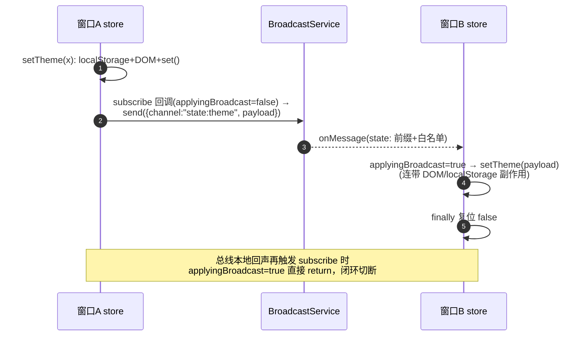
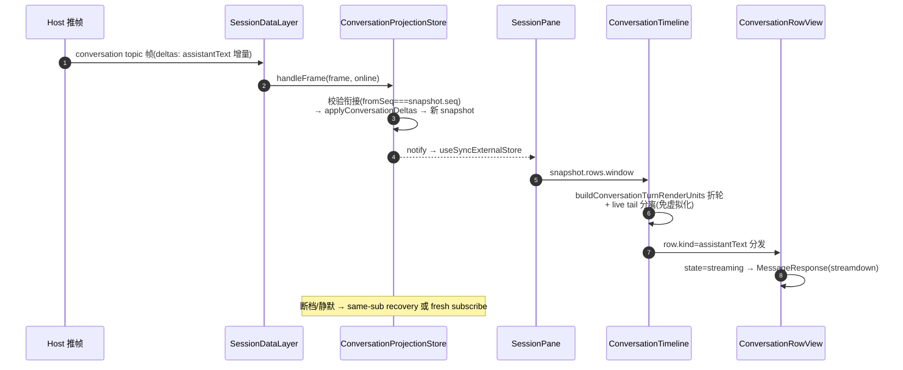
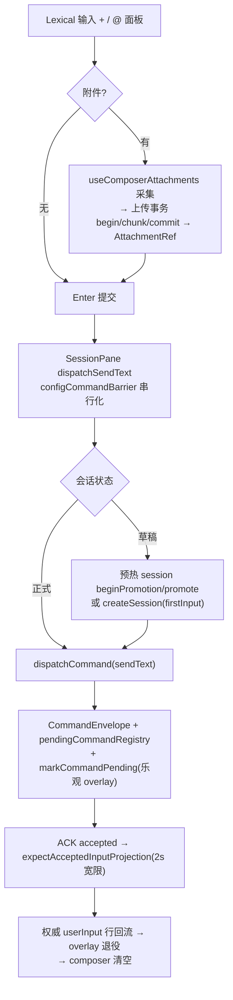
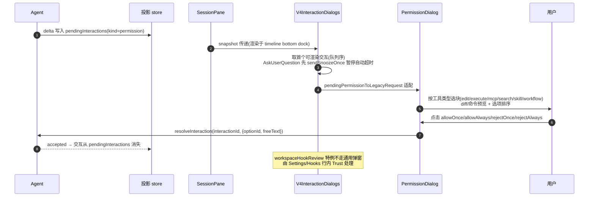

# packages/ui — 业务 UI（状态层 + 组件层，函数级）

1477 个 ts/tsx 文件，桌面/Web/TUI 共用内核。本报告分两部分：A. 状态管理与服务访问层；B. 展示组件与视图层。

## A. 状态管理与服务访问层

### A1. store/ 清单（38 文件）

| store | 关键状态 | 要点 |
| --- | --- | --- |
| `index.ts`（502 行，`createZCodeStore` 工厂） | theme/locale/uiFontSizePx/interfaceMode/user/OAuth 序列/CodingPlan 重置三张表 | **广播核心**：`BROADCAST_FIELDS={theme,locale,uiFontSizePx,interfaceMode}`(:214)，频道前缀 `state:`(:219)；防回环闭包标志 `applyingBroadcast`(:236)；手写 localStorage 持久化（无 persist 中间件） |
| `zcodeSessionStore.ts` | 按 workspace 分桶 `workspaces: Record<key, WorkspaceZCodeUIState>`；组合 navigation/workspace/task 三 slice | 桶 key=`resolveWorkspaceStateKey`（`workspaceIdentity?.trim() \|\| workspacePath`，selectors.ts:25）；E2E 桥 + 内存诊断注册 |
| `zcodeSessionStoreTypes.ts` | `WorkspaceZCodeUIState`：activeTaskId/draftSessionId/draftRuntime/taskRuntimeByTaskId/taskUiByTaskId/optimisticTaskListByTaskId/configOptions…；`ModelSwitchStage` 8 阶段(:115-122) | 草稿锚点 groupedDraftTask（UI-only，不入 task index） |
| `tabStore.ts`（655 行） | tabs/activeTabId/expandedWorkspacePaths | addTab identity 优先匹配防同路径远端混淆(:257-306)；两阶段恢复 restoreTabs→completeTabRestore(:574-651)；每窗口独立不广播 |
| `taskQueryCacheStore.ts`（1012 行） | resultsByQueryKey/taskMetaByEntityKey/**taskUnreadOverlayByEntityKey**（pending overlay） | `invalidationVersion` 代际丢弃过期异步结果(:25-50)；等价结果跳过 setState |
| `remoteWorkspaceSessionStore.ts` | baseServices + sessionsById（远程 session 的 services 与 dispose） | registerRemoteWorkspaceSession/unbind |
| 领域 store | mcpStore(729)/pluginManagementStore/pluginStore/skillStore/hooksStore/commandsStore/subagentsStore/automationManagementStore/offPeakTaskStore/conversationShareSelectionStore/whiteboardStore/savedWorkflowStore/dynamicWorkflowAvailabilityStore/composerAttachmentUploadStore/workspaceHookReviewStore/codeCommentPreviewStore/confirmDialog/alertDialog… | 均内存态按 workspaceKey 分片；codingPlanQuotaResetState 含跨窗口「只播一次」分布式租约（`broadcastService.acquireClaim`，:294-330） |

### A2. hooks/（98 文件）与 DI

- DI 上下文：`useServices.tsx:11-31`（ServiceProvider → `IServiceAccessor`，三层嵌套：app 级 `Root.tsx:118` → workspace 级 → v4 pane 级）；`usePlatform.tsx:12-33`（IPlatformService 注入）。
- **workspace 服务路由层** `useWorkspaceServices.tsx:156-215`：依据 tabStore 远程元数据 + remoteWorkspaceSessionStore 解析三态 `local-ready / remote-waiting / remote-ready`；断连代理 `createDisconnectedRemoteServices`（所有命令 reject `REMOTE_WORKSPACE_DISCONNECTED_ERROR_CODE`，:31-45）。
- 分组：服务上下文（4）、设置/凭据/账号（10+）、任务/会话（15+）、Git（4）、文件/系统/终端（8+）、插件/工作流/自动化（15+）、Shell 编排（useAppPanels 60+ handler/useAppKeyboard/useTabPersistence）、远程连接（8）、弹窗等。

### A3. Provider 装配顺序（`Root.tsx:104-141`）

```
LucideProvider → TooltipProvider → ServiceProvider(services) → PlatformProvider(platform)
→ StoreProvider(broadcastService) → TabStoreProvider → DiffsWorkerPoolProvider
→ AssistantCodeCommentFeatureProvider → CodingPlanUpgradeDialogProvider → RootInner
```

宿主再包 `AppErrorBoundary → ZCodeIntlProvider`（desktop `main.tsx:327-350` / web `main.tsx:448-469`）。RootInner 启动序列（`Root.tsx:143-1068`）：mcpStore platform 注入 → 灰度加载 → 广播监听 → provider 迁移 → OAuth 恢复 → tab 两阶段恢复 → 启动 loading 门 → 空工作区兜底 `ensureConversationWorkspace` → RootWorkspaceContent（设置页用 opacity+inert 覆盖而非卸载，`RootWorkspaceContent.tsx:101-123`）。

### A4. 广播防回环流程



（locale 链路另有 IntlProvider 的 `ignoredLocalPayload`+`sourceWindowId` 双保险，`i18n/IntlProvider.tsx:93-111,290-344`；system 模式用宿主 `resolveSystemLocale` 防中文系统被持久化为英文 :244-251。）

### A5. logger.ts 与 replay.ts

- logger：debug 生产 no-op；桥 `window.zcode?.log` 只收 info/warn/error；`logger.trace(traceId,level,...)`；例外通道 `logMemoryDiagnostics`（60s 采样，生产仍走桥）。
- replay.ts：纯 re-export 桶（「只 re-export，不定义任何东西」，:7），为浏览器静态回放页放出 SessionPane/V4ConversationContext/SessionDataLayer/Provider 族 —— web-remote-replayable 的 run 详情装配复用同一套组件与数据层。

## B. 展示组件与视图层

### B1. 组件体系（按功能域）

| 域 | 关键组件 | 说明 |
| --- | --- | --- |
| 会话主视图 v4/（203 文件） | V4ChatPane → WorkbenchPane（分屏叶子）→ V4WorkspaceChatArea；SessionPane(4835 行，命令编排收口)；ConversationTimeline(虚拟滚动+滚动锚定+live tail 分离)；ConversationTurnGroup/RowView；ConversationComposer + composer/(37 文件) | 详见 B2 |
| 输入区 | LexicalChatInput(1531 行, 12 插件栈)；prompt-editor/；chat-input-toolbar/(17) | 详见 B3 |
| 工具渲染 | ToolCallBlocks.tsx + ToolCallBlocks/(74 文件，renderers/ 60 个)；v4/toolCallRowAdapter | 详见 B4 |
| 侧栏任务 | WorkspaceSidebar(1700 行)；TaskList(legacy)；workspace-grouped-tasks/(20, 虚拟化分组) | v4 侧 sessionsIndexStore |
| Git | GitPane(546)；git-graph/(含纯算法 layout) | diff 懒加载+虚拟列表 |
| 预览/终端/白板 | PreviewPane(1806)+9 个 previewPane*Content；Terminal+terminal/(xterm+FitAddon)；WhiteboardPane；TreemappingPane | office docx/xlsx/pptx/pdf |
| 设置 | SettingsPage(1962)+settings/(215 文件) | MCP/Hooks/Commands/Plugins/Automations/Provider/… |
| 远程/浏览器/CUA | SSHDialog+remote-connection/；EmbeddedBrowserPaneParts+browser-use/(15)；cua-permission/ | 截图合成层处理收起面板 |
| 命令面板 | command-center/CommandCenterDialog(1072, 基于 cmdk)+quickpick/ | 命令/会话/文件三类结果 |
| 基础库 | components/ui/(46, shadcn 风格「三方库不要修改」)；components/ai-elements/(44) | DESIGN.md 语义 token 体系 |

### B2. v4 会话投影（深读）

分层：`V4PaneConversationProvider`（从 workspaceConnectionRegistry 租共享 transport+layer）→ `SessionPane`（`layer.acquire(sessionId)` 得 **SessionLease**）→ `useConversationProjection(lease)`（useSyncExternalStore）。

| 组件 | 位置 | 要点 |
| --- | --- | --- |
| `SessionDataLayer` | `sessionDataLayer.ts` | `Map<topic,{store,refCount,keepWarmTimer}>`；release 幂等，引用归零 **30s keep-warm** 再退订（「关 pane≠停 session」，:72-163） |
| `ConversationProjectionStore` | `conversationProjectionStore.ts`（1354 行） | 只读投影；三规则：snapshot 整体替换绝不 merge；delta 仅 `fromSeq===snapshot.seq` 衔接才 apply；断档携水位重订阅服务端裁决(:2-7)。对外：connect/handleFrame/markCommandPending/settleCommand/expectAcceptedInputProjection/loadOlder/retry/close |
| optimistic overlay | 同上 :1202-1296 | 命令上行→markCommandPending；投影出现 `userInput.sourceCommandId` 行后退役；accepted-input 2s 宽限自愈（:60-68） |
| 恢复 | 同上 :536-550,866-876 | runtime 换代有界退避 250ms/1s/3s；notOwned 特判 fresh subscribe |

### B3. 聊天输入（LexicalChatInput 插件栈）

`LexicalChatInput.tsx:1479-1523`：PlainTextPlugin+HistoryPlugin（基础/撤销）、PromptClipboardPlugin（富粘贴→附件）、TextContentPlugin（onChange+延迟打点）、KeyboardPlugin（Enter 裁决+IME 保护）、PromptHistoryPlugin（↑/↓）、LeadingChineseSlashAliasPlugin（「、」→「/」）、PasteCapturePlugin、SlashCommandPlugin（`/` 面板）、MentionPlugin（`@/#/$`，providers：file/plugins/sessions/skills/subagents/whiteboard）、Editable/E2E 桥/EditorApi。

附件上传状态机：`useComposerAttachments`（并发 2、失败重试 500ms、换代重传上限 5）→ `composerAttachmentUploadStore` → `uploadAttachmentTransaction`（begin→384KiB chunk（base64+SHA-256）→commit；异常 abort）→ 草稿绑定预热 session 预传（禁止点击时起上传）。

### B4. ToolCallBlocks（数据驱动注册表）

`resolveRenderer.ts:57` `resolveToolCall(context)` 分流：①`kind` 特判聚合组（changesGroup/executeGroup/cuaGroup 连续折叠）②按名认领（SaveWorkflow/ListModels/Escalate/ResolveWorkflowQuestion…）③MCP 通用块（Node REPL 先拦截）④按 tool identity `family` 分发（plan-guidance/agent/todo/ask-user-question/file-read/write/explore/shell/goal…）⑤兜底 FallbackToolCallBlock（raw JSON 卡）。

### B5. 关键流程图

#### 流式消息渲染链



#### 输入→附件→发送



#### 权限对话框



### B6. workers/

`workers/diffs.worker.ts`（1 行，装载 `@pierre/diffs` worker，diff 计算移出主线程）；`workspace-file-search/workspaceFileSearchFilter.worker.ts`（文件搜索过滤 + backend 降级）。

## 深读/采样说明

深读全文：conversationProjectionStore/sessionDataLayer/V4ConversationContext/useConversationProjection/attachmentUploadTransaction/attachmentUpload/resolveRenderer/useTheme/workers/diffs.worker/DESIGN.md。深读关键段：SessionPane(props/发送路径/render 尾段)、ConversationTimeline、ConversationRowView、ConversationComposer、LexicalChatInput、PermissionDialog、V4InteractionDialogs、CommandCenterDialog、store/index、tabStore、zcodeSessionStore 族、taskQueryCacheStore、codingPlanQuotaResetState、IntlProvider、App/Root/RootWorkspaceContent、hooks 核心族、i18n。结构采样：其余 37 个子目录逐一枚举归责 + 代表文件 outline。
