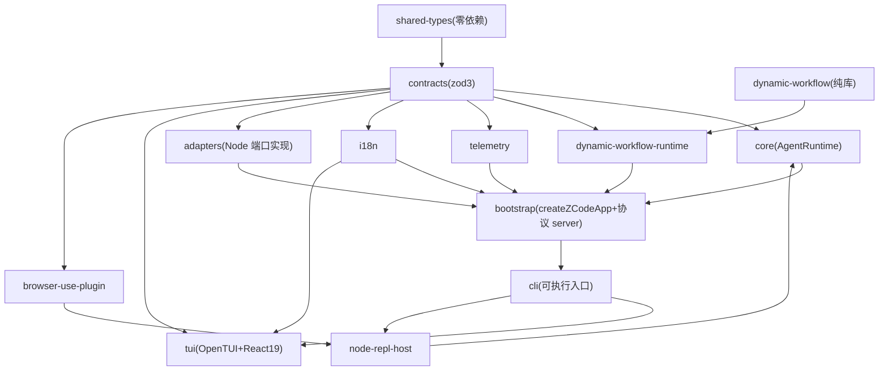
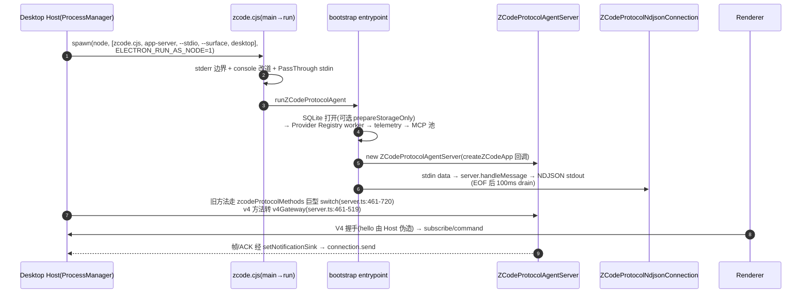
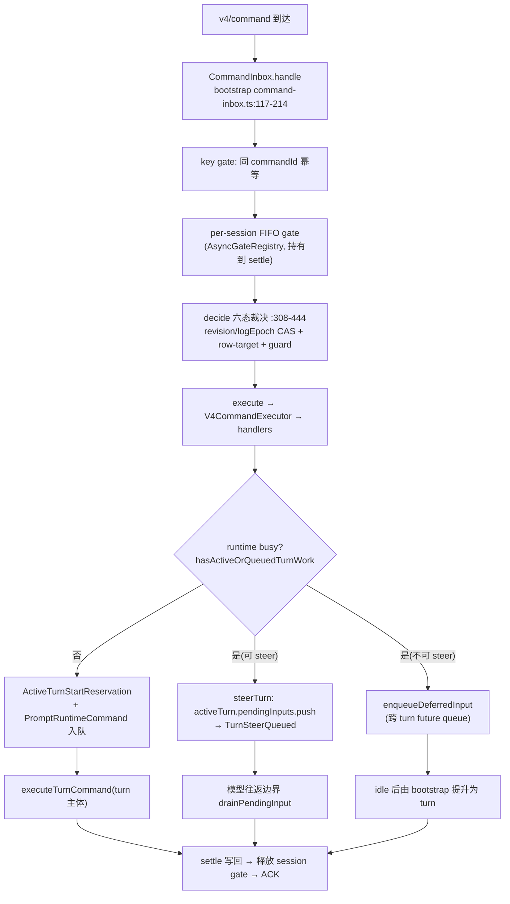

# apps/zcode-cli — Agent CLI 与运行时（函数级）

内嵌独立 pnpm workspace（17 子包 + 2 工具），1354 个 ts 文件。既作终端 Agent，也为 Desktop/Web 提供 Agent 运行时。

**事实核查**：本 CLI **无 `--web` 参数**（`packages/cli/src/arguments.ts:3-106` strict 模式未注册）；`zcode --web` 属外层发行包 `scripts/zcode-distribution/runner.mjs`。

## 1. 子包依赖图（turbo `build` dependsOn `^build`）



`build:desktop-agent` 显式 7 依赖链且 inputs 拉取**外层仓库** shared/provider 源码与 `.env.*`（`turbo.json:57-80`）。

## 2. CLI 入口（深读）

- bin：`zcode → dist/zcode.cjs`（esbuild 单文件，`build.mjs:235`，`__CLI_VERSION__` define）。
- 参数解析：Node 内建 `parseArgs`（自研非 commander，`arguments.ts:1`，strict）；`--disallowedTools` 手工抽取支持 `Bash(git *)` 规则（:127-161）。
- `main.ts` 启动链：`setCliProcessTitle`(:19) → `applyCliRuntimeEnvSanitization`(:22) → `isProtocolServerInvocation`(:23) / `isTuiInvocation`(:24, 无参数默认 TUI) → 协议模式装 stderr 边界 + PassThrough 生命周期（父端 EOF→abort，`protocol-lifecycle.ts:10-72`）→ `ensureSeaRuntimeTools`(:52) → 动态 `import("./run.js")`。
- `run.ts` 三模式分发(:286-575)：旁路（`__internal-search`/plugin-host/dwf-child/hooks）→ `--prompt` 无头模式 → positionals switch（`app-server` → `runZCodeProtocolCommand`；默认 `tui` → `runTuiCommand`）。
- `--surface`：`terminal→terminal`、`desktop→zcode_desktop`（`core/src/context/types.ts:56`）；core 的 `context/builder.ts:131` 在 zcode_desktop 时注入 `buildDesktopContextSection()` 到 system prompt。

## 3. app-server/stdio 模式（供 Host 驱动）



注意：CLI app-server 不发 `zcode-hello`（那是远端 zcode-server 专用，`server/src/entry-stdio.ts:41`）；其握手是 V4 wire 层 `helloMessageSchema/clientHelloSchema`（`shared/zcode-protocol-v4/transport.ts:35/62`），Host 侧由 services 伪造可信 hello（`zcodeAgentService.ts:4875-4911`）。

## 4. AgentRuntime 主循环（core，深读）

### 4.1 三层嵌套

```
executeTurn (turn.ts:70-91) → 不直接执行，包成 PromptRuntimeCommand 入 RuntimeCommandQueue
  ↳ drainRuntimeCommandQueue (runtime-command-queue.ts:37-70, 防重入)
    ↳ beginForegroundExecution (:396-423, AbortController = Stop 取消域)
      ↳ executeTurnCommand (turn.ts:93-846)
        ↳ runRegularTurnLoop (turn-loop.ts:43-219, while(true))
          ↳ runModelBackedTurnStep (turn-model-step.ts:133-733)
            ↳ runModelTextRequest (model.ts:36-518)
            ↳ executeToolCallsForModelStep (turn-tools.ts:43-478)
```

turn 命令队列优先级 `now(0)<next(1)<later(2)`；`dequeueNextBatch` 把同优先级 task-notification 合批（`command-queue.ts:184-203`）。

### 4.2 一次完整 turn（时序）

```mermaid
sequenceDiagram
    autonumber
    participant IN as CommandInbox
    participant RT as AgentRuntime
    participant LP as runRegularTurnLoop
    participant MD as Model(streamText)
    participant TC as StreamingToolCoordinator
    participant TE as ToolExecutor(call-runner)
    participant PS as PermissionService/Broker
    participant ES as eventStore(sqlite)
    participant PB as V4 Publisher

    IN->>IN: handle: 幂等 gate → session FIFO gate → decide 六态
    IN->>RT: accepted → app.sendInput → runtime.admitPrompt
    RT->>RT: 空闲: reservation + 入队; busy: steerTurn/enqueueDeferredInput
    RT->>ES: ensureSessionPersisted → appendEvent(TurnStarted)
    RT->>LP: 注入 user 消息 + UserPromptSubmit hooks
    loop 模型步循环
        LP->>LP: microcompact/autoCompact → initializeMcp/getTools → reminders
        LP->>MD: buildRuntimeProviderRequestMessages → streamText
        MD-->>PB: text_delta/tool_call 事件流(背压队列)
        MD->>TC: during-stream 只执行 readOnly 工具
        TC->>TE: 流结束 drain
        TE->>PS: resolveToolPermission(ask 时)
        PS-->>TE: 用户裁决(broker 与 PermissionRequest hook 竞速)
        TE->>ES: tool part completed + tool_result 入历史 + checkpoint
    end
    LP->>RT: 无更多工具 → finishModelStepWithoutToolCalls
    RT->>ES: TurnComplete + rebuildProjection
    RT-->>IN: settle → ACK
```

### 4.3 工具系统

- `ToolRegistry`（`core/src/tool/registry.ts:12-147`）：canonical 名+alias，冲突拒绝；`toContracts()` 只导出 providerVisible!==false 的契约。MCP 工具 `registerMcpTools`（`runtime/methods/mcp.ts:138-148`）。
- 执行器 `executeToolCall`（`executor/call-runner.ts:65`）：语义校验(:192) → PreToolUse hooks(:232) → `resolveToolPermission`(:289) → handler → PostToolUse hooks(:471)。
- 权限流（`executor/permission-flow.ts:41-431`）：PermissionContext 组装 → 项目 ruleset → `permissionService.checkPermission` → hook 覆写 → ask 时发 PermissionRequested → `racePermissionResponders`（broker 与 hook 竞速 :184-236）→ deny/escalate/modify/allow 分支（含 permissionUpdates 持久化与会话级 grant）。
- **权限模式**（`permission/service.ts:97-231`）：`yolo` 全放行(:136-138)；`auto` 未实现直接 deny；`plan` 只读+显式能力(:404-446)；`edit`（acceptEdits）workspace 副作用放行(:518-532)；`build`（default）只读放行/critical ask/session 低风险放行(:452-516)。
- 调度 `ToolScheduler`（`scheduler.ts:50-227`）：依赖拓扑排序 → level 分 parallelGroups（`maxConcurrency` 默认 10）→ 环检测。

## 5. 会话持久化（事件溯源 + sqlite，非 JSONL）

- `appendEvent`（`runtime/methods/events.ts:81-147`）：`eventStore.append`（补 sequenceNumber）→ `persistDurableSessionEvent` → usage 记账 → `notifyEventSinks`（live sink 只见已落库事件）。
- 投影：`EventReducer`（`contracts/src/events/event-reducer.ts:74`）全量 reduce；core `getProjection()` 即此。存储 `adapters/src/storage/session-store/sqlite-session-store.ts`（node:sqlite）+ 多 repositories（sessions/messages/session-entries/todos/usage/input-history/dwf-journal）。
- Compact/Checkpoint/Rewind：手动/自动/反应式/micro 四级 compact（`compact.ts:45,184,352`、`microcompact.ts:24`）；`emitFileMutationCheckpoint`（turn-tools.ts:370）；`executeRewindCommand`（`rewind.ts:36`）；会话 fork（`session-fork.ts`）。

## 6. CommandInbox（busy 输入串行 admission，两级队列）



held 语义：turn 完成 + queue>0 + autoDrain=false → 翻 false（`turn.ts:742-762`）；恢复裁决 `applyHeldQueueDisposition`（`session-flow.ts:105-131`）。

## 7. Subagents

- 端口 `createDefaultSubagentPort`（`runtime/methods/subagent.ts:59-210`）：构造子 `AgentRuntime`（child 模型工厂/权限模式/工具 allowlist/borrowed 或独立 MCP）。
- 运行器 `createExploreSubagentPort`（`subagent/runner.ts:131+`）：launch（前台 run/后台 start）→ RuntimeTaskRegistry → activity watchdog → `runAgentToCompletion`(:1116-1188)；后台完成 `finalizeBackgroundCompletion` → `enqueueParentTaskNotification` → `TaskNotificationRuntimeCommand`（下一轮 drain 或 idle 批处理）。
- 子代理→父会话消息：`SubagentMessageRuntimeCommand` 以 `inputVisibility:"model-only"` 跑 turn。

## 8. dynamic-workflow（三段式设计）

| 层 | 包 | 内容 |
| --- | --- | --- |
| 纯库 | `dynamic-workflow` | facade `agent()/ask()/report()/log()/phase()` + world-read（`facade/dts.ts:65-256`）；编译（虚拟 host typecheck，import/process/fetch 编译期失败）；分析（taint 解释器→四投影）；引擎 `AskScheduler`（`scheduler.ts:38`：ordinal/journal replay/hold 规则/cached settle） |
| app-free 运行时 | `dynamic-workflow-runtime` | `harness.ts`：写 `.zcode/workflow-runs/<runId>.mjs` → spawn node 子进程 → NDJSON 协议（child→parent create-actor/request/event/complete；parent→child response）→ 桥接 WorkflowEngine；SEA 支持 argsPrefix re-exec |
| 生产 driver | bootstrap | core 工具 CreateWorkflow（compile→审批 gate→`dynamicWorkflowRunPort.submit`→backgrounded）；`dynamic-workflow-run-service.ts`（643 行：快照/等待/取消/恢复）；actor 会话 `script-workflow-child-runtime.ts:62-111` |

## 9. TUI（深读）

- 框架：OpenTUI + React 19（`@mbears/opentui-*` 0.2.15 + shiki + web-tree-sitter），非 ink。
- 启动：`tui.tsx:13 runTui`：TTY 校验 → `createCliRenderer`（30fps、鼠标、Ctrl+C 退出关闭但 SIGPIPE 排除、consoleMode disabled）→ 首帧先渲染 StartupScreen，首个 FRAME 事件后异步加载启动数据再 `renderApp(TuiApp)`（首帧不被 IO 阻塞）。
- 组件：`TuiApp`（`app.tsx:44-419`，React hooks 状态机：messages/draft/busy/mode/model/todos/queuedInputs/approvalQueue/workflowRuns/sidebar/subagents）→ AppShell+Sidebar+ContentPane（thought/tool/markdown/shiki diff 组件族）+InputPane+ApprovalPanel。
- 桥接（cli 包是桥，tui 包纯 UI）：`createTuiSubmitPrompt`（`tui-prompt-handler.ts:50-389`）——首次提交才惰性 `prepareTuiAppRuntime`（dotenv→resume→telemetry→**进程级 Provider Registry 常驻**）→ `createZCodeApp`；`/new /resume /fork` 经 `replaceApp` 换 App 并幂等重挂常驻事件订阅（`tui-session-event-relay.ts:24-63`）；事件回灌 `useSessionEventApplier`（主会话闸门 + 2048 深度 id 去重窗，`app-session-event-handler.ts:17-97`）。

```mermaid
sequenceDiagram
    participant K as useKeyboard
    participant SC as useSubmitValue→submitIdleTurn
    participant TP as TuiPromptHandler(commandCenter)
    participant AR as AgentRuntime
    participant SR as sessionEventRelay(常驻)
    participant AP as applySessionEventToState

    K->>SC: Enter 提交
    SC->>SC: 本地先插 user 消息(local-user-* id)<br/>+ AbortController 绑定
    SC->>TP: options.submitPrompt(input,{onEvent,requestPermission})
    TP->>TP: commandCenter 判定(slash 或普通)<br/>首次: prepareTuiAppRuntime + createZCodeApp
    TP->>AR: app.submitPrompt
    AR-->>SR: SessionEvent 双 sink(per-turn onEvent + 常驻 relay)
    SR->>AP: 闸门过滤 + id 去重 → 归约进 React state
    Note over AP: 30fps 重绘; 工具权限 → approvalQueue → ApprovalPanel
    AR-->>SC: resolve → applyResult(追加终态消息, 流式已投不重复)
```

## 10. contracts 与 zod 边界

- contracts（zod3 + zod-to-json-schema）：端口接口、SessionEvent、工具 schema；re-export shared 的少量常量/类型（`contracts/src/index.ts:99-110`）；跨边界工具 schema 统一转 JSON Schema（`tools/json-schema.ts:23-33`，provider 永远看不到 zod 实例）。
- 打包期 `createZodDedupePlugin`（`cli/scripts/build.mjs:74-104`）按版本各归并单一安装根 + `assertZodBundleIdentity`(:59-69) 锁死 zod4 精确版本——**bundle 同时含 zod3/zod4，靠版本隔离共存**。

## 11. 其余包

| 包 | 说明 |
| --- | --- |
| adapters | Node 端口实现：auth OAuth/browser(Playwright)/config 层叠/exec bash/fs/http/skills/storage sqlite/workflow |
| node-repl-host | node_repl 工具 worker 宿主 + MCP stdio server + browser/CUA bridge（避免 core 全图入 bundle，`server.ts:1-40`） |
| browser-use-plugin | 官方插件，向 node_repl globals 注入浏览器运行时 |
| swift-bridge / superpowers-plugin | 占位（darwin stub / 仅 LICENSE） |
| debug | Hono+Vite 调试工作台（vis-timeline 甘特、network capture） |
| telemetry | OTLP exporter（trace+metric proto）、agent trace runtime、model API recorder、脱敏 |

## 12. SEA 打包

`build:sea`：turbo 全依赖 → esbuild 单文件（zod 去重）→ `build-sea.mjs`（6 平台 target）：下载 Node 二进制 → sea-config（assets 五族：opentui 原生包/官方插件/bfs-rg-ugrep/playwright/provider config）→ blob → postject 注入（找 `NODE_SEA_FUSE` 翻转）→ mac ad-hoc 签名 / win 清 Authenticode。运行期 `ensureSeaRuntimeTools` 从 `sea.getAsset` 解出三件套（sha256+marker 校验）。

## 13. 深读/采样说明

深读：cli 入口族（main/arguments/run/tui-command/tui-prompt-handler(+runtime)/tui-session-event-relay/bootstrap-loader）、tui 启动与提交链、bootstrap 的 zcode-protocol-entrypoint 与 create-app 关键段、v4 协议层（command-inbox/executor/prompt-turn/handlers）、input-facade、core 的 runtime 主链（agent-runtime/turn-machine/turn-state/turn/turn-loop/turn-model-step/turn-tools/command-queue/prompt-admission/runtime-command-queue/model/tools/events/mcp/steering/streaming-tool-coordinator）、tool 三件套（registry/scheduler/executor）、permission（service/broker）、internal、dynamic-workflow 三边界。采样：compact/rewind/checkpoints/resume/subagent/fork、v4-gateway 规模段、dwf 引擎、adapters/其余小包。
