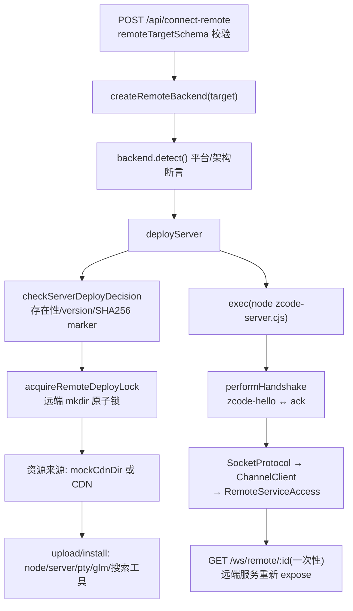
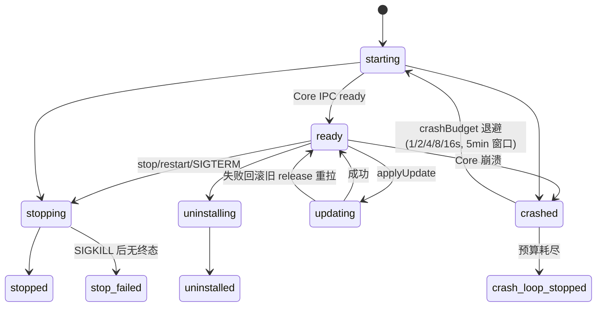
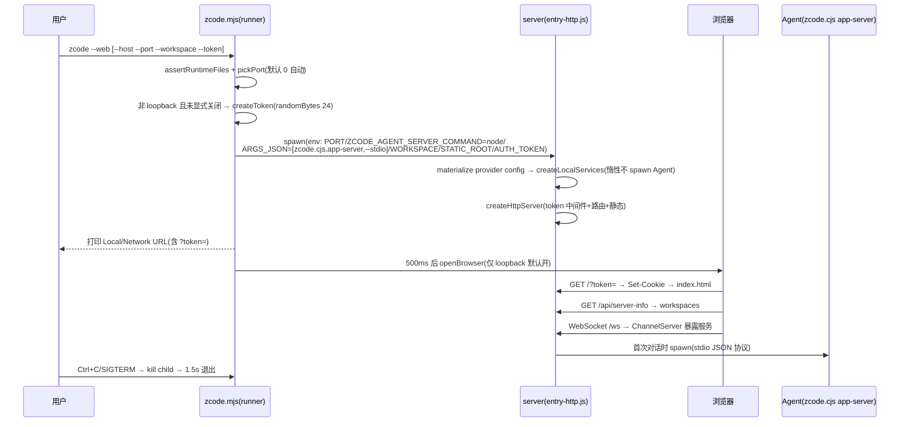

# packages/web + packages/server + packages/zcode-server-cli（函数级）

三个包构成「Web / 命令行版」体系。**事实核查**：`zcode --web` 入口在外层 `scripts/zcode-distribution/runner.mjs`（打包复制为发行包 `bin/zcode.mjs`，`scripts/build-zcode.mjs:199-204`）；`packages/zcode-server-cli` 是守护进程版 CLI（serve/status/stop/restart/update/uninstall）。

## 1. 模块地图

| 包 | 模块 | 职责 |
| --- | --- | --- |
| web（17 文件） | `src/main.tsx`(477 行)、`auth/`(7)、`share/`(5) | 启动编排（OAuth 回调/分享页/主应用路由分发）、ZAI/BigModel OAuth、`/share/:code` 落地页 |
| server（51 文件） | `src/http.ts`(426)、`entry-http.ts`、`entry-stdio.ts`、`stdio*.ts`、`hostCapability.ts`、`remote/`(36 文件) | Hono HTTP+WS 全路由、token 鉴权、stdio 形态、一次性 host capability、SSH/WSL/Docker 远程 |
| server-cli（43 文件） | `cli.ts`(517)、`server-core/`、`supervisor/`(565+crashBudget)、`ipc/`、`runtime/`(21)、`packaging/`、`platform/` | 守护进程：Supervisor/Core 分进程、JSON-line 控制协议、release 管理、OS service 注册 |

## 2. server 深读

### 2.1 HTTP 路由清单（Hono，`src/http.ts`）

| 路由 | 行 | 说明 |
| --- | --- | --- |
| `GET /api/server-info` | :317 | ServerRemoteInfo：serverId/version/protocolVersion/authRequired/workspaces/capabilities |
| `POST /api/rpc-host-capability` | :318 | 签发一次性 host capability ticket |
| `GET /ws` | :322-329 | WS 升级，**强制 clientMode=web-remote-replayable**（防浏览器借旧 mode header 提权） |
| `GET /ws/host` | :336-343 | 先 capability 中间件，再升级为 desktop-continuous |
| `POST /api/connect-remote` | :346-365 | `remoteTargetSchema` 校验（ssh/wsl/docker）→ createRemoteBackend+connectRemote → 存 Map（随机 id） |
| `GET /ws/remote/:id` | :368-397 | 取出（一次性）远程连接，远端 4 服务重新 expose |
| `GET *` | :399-414 | 静态 + SPA fallback（不适用 /ws、/api）；index.html no-cache |

### 2.2 WS 传输与越权防护

传输是**自定义二进制 RPC**（非 JSON 文本）：`wrapWebSocket` → ISocket → SocketProtocol → ChannelServer → LoggingChannelServer（`http.ts:41-92`）。`setupChannelServer(ws, services, clientMode)`（:83-122）核心：

- 每 attachment 建 `createZCodeAgentConnectionScope({connectionId:"server-ws-<uuid>", clientMode, role})`：desktop-continuous→trusted-host-relay，web-remote-replayable→terminal-client（:94-104）。
- scope.service 以 override 替换 `IZCodeAgentService` channel（:101-104）。
- **越权防护**：非受信客户端拿到 `IProviderProvisioningTargetService` 的是一个 `apply()` 直接抛错的 stub（:105-116）。

能力差异：trusted-host-relay 免 V4 hello（`zcodeAgentConnectionScope.ts:236-239`）、可 `setConnectionFlowStateV4`、relay 下游身份（`namespaceRelayConnectionId`，:177-184）；terminal-client 必须先 `helloConversationV4 → initializeConversationV4`（clientId 绑定，命令校验 `envelope.clientId !== boundClientId` 抛 `fault.command.clientMismatch`，:649-698）。

### 2.3 认证机制

1. **Lite token**（`ZCODE_SERVER_AUTH_TOKEN` / `authToken`）：`/ws`、`/api/*` 受保护；URL `?token=` 匹配则 `Set-Cookie zcode_lite_token`（HttpOnly），之后凭 cookie（`http.ts:224-234`）。
2. **Host capability**（`x-zcode-rpc-host-capability` header，`channels.ts:498`）：`issue()` = randomBytes(32).base64url、TTL 30s、仅存内存（`hostCapability.ts:4,17-41`）；`consume()` **一次性**——成功/过期/重放都先删除（:42-52）。设计动机（`channels.ts:496-497` 注释）：旧 client-mode header 是「可重放的长期提权声明」故废弃。

### 2.4 与 Agent 的连接

- 本地：`createLocalServices` 内 `ZCodeAgentProcessManager` 按 workspace spawn。命令解析链 `resolveDefaultZCodeAgentCommand`（`zcodeAgentProcessManager.ts:438-464`）：`ZCODE_AGENT_SERVER_COMMAND/ARGS_JSON` env 最高优先（`--web` 正是靠它注入 `node agent/zcode.cjs app-server --stdio`，`runner.mjs:183-184`）→ dev → Electron runtime → 已部署 native binary。
- 远端：经 `connectRemote` attach 远端 stdio server（§4）。

### 2.5 多客户端同步

每个 WS/stdio attachment 一个 `ZCodeAgentConnectionScope`（`zcodeAgentConnectionScope.ts:223-1048`）：

- 三类 V4 topic：conversation / sessions-index / workspace-config（:123）。
- **订阅 ownership**：`owned` Map（routeKey=kind+workspace+topic+subId+connectionId）；ACK 前的 pending staging（≤1024 帧/32MB，超限整批 `fault.subscription.initialFrameStagingOverflow`，:164-166,429-445）——解决「CLI notification 先于 subscribe ACK 到达丢帧」（:590-602）。
- 流控：`setTransportFlowState`（drained/saturated/closed）按 route 转发 base；close 必须排在已入队 SAT/DRN 之后（:1016-1019）。
- base service 只转发 CLI 事实、不做状态复制（文件头注释 :1-4）；多客户端靠 per-scope 独立上游订阅 + workspace 级 fan-out（`onDynamicConversationFrame`，:460-476）。

## 3. server/remote：SSH/WSL/Docker 部署链路

- 抽象 `IRemoteBackend`（`backend.ts:32-49`）：detect/upload/exec/exists/readFile + 可选 resolveRuntimeProxy（WSL）/onDidDisconnect（SSH keepalive 半开补偿）。
- 工厂（`create-backend.ts:6-35`）：ssh（ssh2+keyboard-interactive+SFTP）、wsl（`wsl.exe`）、docker（`docker exec` / `cat >` 上传）。
- 连接五步（`connect.ts:161-322`）：detect → deployServer → exec 远端命令（`SERVICE_AUTHORITY_MODE_ENV=desktop-attached-remote` 等白名单 env）→ `performHandshake`（跳 banner、读 zcode-hello、写 ack）→ wrapStdioStream→SocketProtocol→ChannelClient→RemoteServiceAccess。
- 部署（`deploy.ts:95-471`）：决策检查（node 存在/`--version` 比对/SHA256 marker，版本变化持久化 refresh-pending，:481-550）；远端 install-root **mkdir 原子锁**（`remoteDeployLock.ts:39-52`，stale 检测 + owner token；桌面 SSH 可 caller-serialized 跳过）；双安装器 LocalUpload（SFTP）/RemoteDownload（远端 curl CDN）；资源：node 运行时、zcode-server.cjs、node-pty prebuild、glm agent+官方插件、bfs/rg/ugrep。

## 4. web 深读

- `bootstrapWebApp()`（`main.tsx:424-477`）路由优先级：OAuth 回调页 → 会话分享页（`/share/:code`，`ConversationSharePreviewClient({baseUrl: origin+"/api/v1"})`）→ 主应用（`?remote=<id>` 时 wsUrl=`/ws/remote/<id>`；否则 fetch server-info 取 workspace）→ `connectViaWebSocket` → `createWebPlatform()` → render Root（Web 特有约束经 props 关闭：`supportsEmbeddedBrowser=false`、`allowRemoteWorkspace=false`）。
- RPC：`connectViaWebSocket`（`client/src/websocket.ts:62-100`）：WebSocket(binaryType=arraybuffer) → wrapBrowserWebSocket → SocketProtocol → ChannelClient+RemoteServiceAccess —— 与 server 侧 ChannelServer 对偶。
- `createWebPlatform`（`main.tsx:190-352`）：Web 降级实现（selectDirectory 返回 null、connectRemote 显式不支持、Notification+声音、openExternal=window.open）。
- OAuth：`WebAuthService.startLogin`（nonce+state）→ ZAI/BigModel authorize → `handleCallback`（state CSRF 校验 → `/api/v1/oauth/token` 换 token → BrowserOAuthCredentialRepo(localStorage) → 安全回跳）。

## 5. zcode-server-cli（守护进程）

### 5.1 架构

`main.ts` → `runServerCli`（`cli.ts:75-114`）：`--server-root` 解析 → 分发 serve/status/stop/restart/update/uninstall；未知命令 `delegateLegacyCli` fork `zcode.cjs`（:505-517）。serve：`--daemon` 注册 OS service（launchd/systemd/Win）或 detached fork supervisor；前台直接 new Supervisor → fork Core（`releases/<rel>/runtime/server-core.js`，release 内 node 运行，`agentWiring` 注入 agent env）。

### 5.2 Supervisor 状态机

- Core（`server-core/core.ts:17-125`）：`createLocalServices({serviceAuthorityMode:"standalone-server"})` → `createCoreHttpServer`（**仅 loopback**，非 loopback 直接抛错，`http.ts:127-132`）→ IPC ready{host,port,version,generation} → 10s 心跳 + task-activity → shutdown 先关 WS（drain 250ms→terminate）再 dispose。
- 控制协议：Unix socket / Windows 命名管道上的 JSON-line + zod 校验（`contracts.ts:85-94`：ping/status/stop/restart/prepare-update/apply-update/prepare-uninstall/confirm-uninstall）；状态落盘 `run/status.json` 供降级读取。
- 任务活动：`taskActivityTracker` 用 `turn.started/turn.terminal` 遥测事实增减 activeSessionIds → runningTaskCount（stop/uninstall/update 门禁，`supervisor.ts:269-272,506-510`）。

## 6. `zcode --web` 启动流程（发行包 runner.mjs）

## 7. 深读/采样说明

深读：server 的 http/entry-http/hostCapability/stdio/entry-stdio/remote 主链（index/connect/create-backend/backend/deploy/handshake）；web 的 main.tsx/auth 链；server-cli 的 cli/contracts/server-core/supervisor/controlServer/paths/agentWiring；跨包 client/websocket、runner.mjs、build-zcode.mjs。采样：ssh-backend 骨架、remoteDeployLock、remoteAssetInstaller、zcodeAgentDeploy、verify-remote-ssh.mjs（端到端契约验证脚本 :234-266）、packaging/stage、taskActivityTracker 全文。
